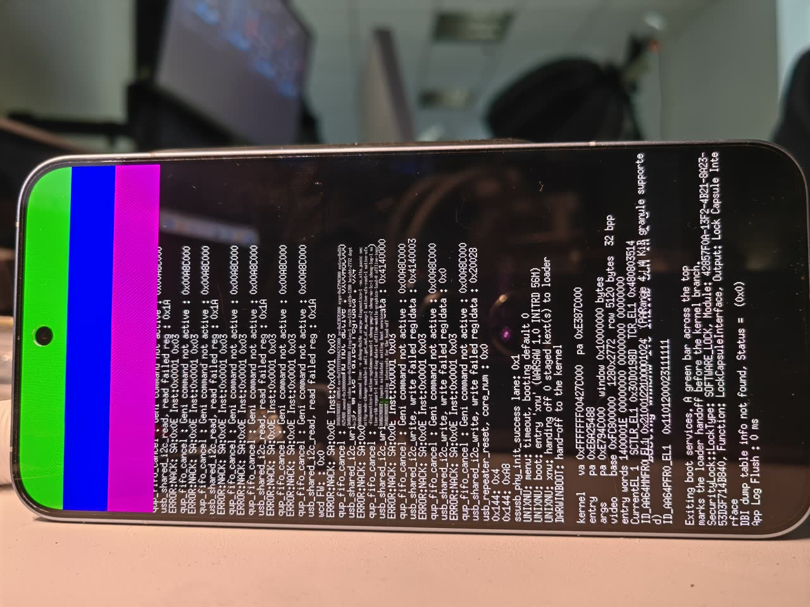
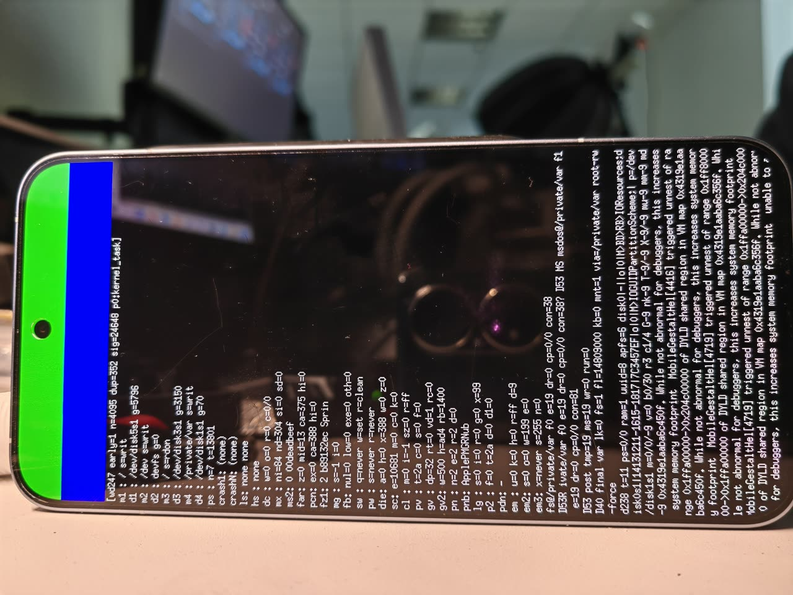
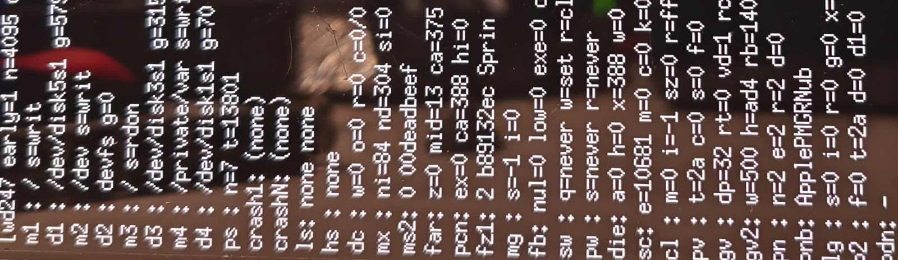

# Booting source-built iPadOS 17.7 XNU on a Snapdragon 8 Elite tablet

中文全文：**[README.zh.md](README.zh.md)**

**Nine days, ~250 numbered board rounds, one lever per round, ~51 minutes of board time per lever.**
Progress report plus six questions for maintainers at the end. All numbers below are measured, not
recalled; where a number drifted between rounds, both values are given.

**If you read only one thing.** Three results from this stretch are portable to any device repo, and one
of them is a correction to something we believed for a week:

1. **A Data seed does not need a Mac.** XNU's own APFS driver mounted a container last written by Linux
   `apfs-dkms` 0.3.18, read-write, verified against a pre-registered capacity cell (§3, §6 item 8).
2. **The wall is not what the corpse list says it is.** Killing the daemon that appears to block launchd
   moved nothing, and neither did giving `/var` its directory skeleton — two whole axes closed as
   negatives (§3 item 4, §7).
3. **The `abort()` has a mechanism, and it is not on the filesystem.** Our images carry the IOReport
   *provider* and no *publisher* at all: no `AppleIOReport` service, no kext, no device-tree node (§7b).
4. **And the correction:** a stock Mac — a reference Darwin — deleted one of our live hypotheses in a
   single command, because the class we were hunting in the IOKit registry is a user-space class and
   appears zero times there on macOS too (§7a). Use one; but write the version gap down first, because
   shapes transfer and version-specific expectations do not.

---

## 1. What the setup is

| | |
| --- | --- |
| Board | device codename `warsaw`, SoC **SM8750 / `qcom,sun`** (the live device tree says `Qualcomm … Warsaw based on SM8750`) |
| OS build | **iPadOS 17.7.11 (21H461)**, kernel collection built from source, upstream pin `82b847c` (2026-11-04) |
| Boot method | `fastboot boot <bootimg>` — RAM boot. The only partition ever written is `misc` (BCB); `boot` / `vendor_boot` untouched, Android boots unchanged when we are done |
| Build host | plain Ubuntu 26.04 box (kernel 7.0.0-42), **no Mac in the loop** |
| Console | **none usable.** The panic screen is the instrument (§4) |
| Round cost | build ≈ 1 min (measured 63 s for two `.c` files through kernel + payload + bootimg, zero warnings) + board ≈ 50 min |
| Bookkeeping | one ledger entry per round (main ledger **1,457,027 B** today) + a separate research ledger (**1,801,121 B**, 152 deep-dive sections); **146 round logs contain a `READ` line**, i.e. 146 rounds with a complete readout |

### 1.1 The board, to the level we have actually measured it

Everything below comes from this board's own `board.toml` and from a device tree dumped off **this
exact phone**, so the addresses are ours to quote rather than a datasheet's.

| | |
| --- | --- |
| Product | **REDMI K90 Ultra**, `model_id = "M332BF"`, community codename `warsaw` |
| SoC | Snapdragon 8 Elite / **SM8750**, family **`qcom,sun`**. Live DT says `model = "Qualcomm Technologies, Inc. Warsaw based on SM8750"` and `compatible = "qcom,sun-mtp qcom,sun qcom,sunp-mtp qcom,sunp qcom,mtp"` |
| CPUs | 8 `cpu@` nodes under `cpus`. The eight `affinity-id` values differ per core, which is why SMP has to run a **single pset** on this tree |
| Display | CSOT **"P12X"** panel driven by a **Novatek NT37801** DDIC, **2772x1280**, single DSI, 4 lanes, **DSC 1.1** (bpc 10 / bpp 8, slice 640x12). Live node `qcom,mdss_dsi_p12x_42_02_0a_dsc_cmd` |
| Touch | Goodix, `xiaomi,touch-spi`, on a QUP serial engine at `0xa88000` — **we do not drive it at all** |
| Timebase / GIC | 19.2 MHz timebase; GIC distributor `0x16000000`, redistributor base `0x16080000` with stride `0x40000` |
| UFS | host `0x1d84000`, PHY `0x1d80000` (`qcom,ufs-phy-qmp-v4-sun`) |
| Storage map | measured 2026-11-04 with `native-ufs-probe=10`: the `userdata` GPT slice on **LUN 0** spans LBA `0x35b000 … 0x7aa93fa` at `lba_bytes = 4096` ⇒ **512.4 GB**. On the Android side it is `/dev/block/by-name/userdata → sda34`, and it carries the SHNGROOT manifest plus the OS/SystemOS windows Android itself boots from |
| What XNU claims | `dram_size = owned_memory_size = 0x10000000` = **256 MiB** of owned DRAM; the payload volume is `WARSAWRAM`, `size_mib = 128` |
| Firmware | Mu-Silicium **`uefi-dada`** build (`firmware.config = "dada"`, `SILICIUM_UEFI.fd`). The ABL we boot through is the vendor's: `fastboot getvar is-userspace` answers `no`, so `fastboot boot` is ABL fastboot, not userspace `fastbootd` |
| Fastboot serial | `b53c187d`, pinned with `-s` on every command — the host has an Android phone on adb at the same time, and multi-device adb without `-s` is one of the pitfalls in §6 |
| Instrument | a Huawei P50 Pro (`L2E0222401016332`) on a tripod, photographing the panic screen (§4) |

## 2. Milestone ladder

We deliberately avoid percentages: the finish line is "SpringBoard reaches the login window", two of
those stages have never been entered on this tree, so the denominator is unknown and further walls
are certain rather than hypothetical.

| # | Stage | Status | Evidence that it is cleared |
| --- | --- | --- | --- |
| 1 | kernel + IOKit init | **cleared 2026-11-05** | the first real death was a data abort inside `IODeviceTreeSupport`; today boot reaches `bsd_init` and IOKit starts |
| 2 | writable APFS root | **cleared at round 77** | root mounts read-write, `decmpfs` compressed reads succeed |
| 3 | dyld shared cache + code signing / AMFI | **cleared, rounds 80s–150s** | daemons exec from the shared cache; `amfi_get_out_of_my_way=1`; the AMFI `EPERM` line still prints but no longer stops the boot, and the "patch the EPERM" arm was judged dead at round 203-B |
| 4 | launchd alive and keeping daemons alive | **cleared at round 200 (11-10 06:03)** | first movement in 30 rounds: `SpringBoard` and `watchdogd` dropped off the corpse list, corpse count **30 → 1** |
| 5 | core daemons | **current wall** | `PerfPowerService` calls `abort()` (SIGABRT); launchd cannot get past it. Round 250 closed the "the seed's `/var` structure is the gate" variant; §7b names a mechanism no seed content can supply |
| 6 | graphics / BackBoard | not entered | one wall already pinned and queued: `FrontBoardServices+0x1e2ec` = "failed to find the main CADisplay" |
| 7 | SpringBoard UI | not entered | — |

## 3. What "success" has meant on this project, concretely

1. **Four stages genuinely cleared** (rows 1–4). Each of them was the wall at the time, and each was
   closed by a behavioural change plus a reading, not by an argument.
2. **An instrument that cannot lie, built out of a phone camera** (§4). This is the part that made
   everything after round 150 possible: we can now tell "the wall moved" from "the reading jittered",
   which we could not do before round 200.
3. **A Linux-side APFS write path** (§6, item 8). `--init-data`'s generator assumes `hdiutil`; we now
   can author a Data seed with real directory content on Linux and validate it off-board with Apple's
   own `apfsck`. The round that tested it produced the stronger result, and it is the one thing from
   this stretch we would tell other device repos: **XNU's own APFS driver mounted a container whose
   last writer was Linux `apfs-dkms` 0.3.18** (capacity cell correct 4 frames out of 5, volume mounted
   read-write). So "a Data seed needs a Mac" is false; `hdiutil` is only needed to *run upstream's
   generator*.
4. **Two well-formed negative results**, each of which closed a whole axis:
   - the **display line** (rounds 214–236, 13 arms: three boot-arg gates → LEGACY display path wired →
     plane published on `gIOServicePlane` → provider class named → `publishOneLayer()` / `IOMFBNumLayers`
     → swap validation → user-client selector map → powered word → NotFound attribution → `dot-pitch`),
     finished with a total negative control at round 237 (IMGF master gate off, source untouched):
     **the wall did not move by one pixel**. Thirteen rounds of work bought the right to delete the
     hypothesis.
   - **killing the daemon we thought was the wall**: we refused to spawn `PerfPowerServices` at all
     (rounds 247–249) and the wall stood exactly where it was — the death census stayed in the same
     band (228..278, and `x` never once dropped below 200 across every round we ever measured). So the
     daemon that appears to block launchd is a **symptom**, not the wall.
5. **A confirmed data-plane fact base, and its verdict**: `/private/var` is mounted, it is **writable**
   (`s=writ`), it is backed by a real disk slice **smaller than 1 GiB** (two other volumes on the same
   screen report 5 GiB and 3 GiB), and that slice is our seed, identified by its capacity cell. "Not
   mounted", "read-only" and "it is the phone's real Data volume" are all dead. What was left — "the seed
   is empty" — round 250 tested and closed (§7): emptiness is not the gate either.

## 4. The instrument, because it dictated the method

Two real photographs, so the constraints below are not abstract:

| | |
| --- | --- |
|  |  |
| **The flood page** (before the panic): the console tail loops, and in the in-focus byte band this page type is 4.68–5.31 MB versus 4.66–4.72 MB for a report page — which is how we locate the paint moment from the chain log alone. | **The report page** (after the panic): the fixed report block, photographed during the 300 s park. The panel has scrolled, so only the last rows exist. |
|  | |
| **What we actually send to the vision endpoint**: the standard block crop (`crop=2060:600:560:2030,scale=2450:710`, then upscaled). It covers roughly the first 26 cells of each row — everything past that has to be cropped separately. | |

No console, so the only channel is the panic screen: the kernel prints a fixed report block and parks
for 300 s before handing the board back to fastboot. A phone on a tripod photographs it and a vision
endpoint transcribes crops. Measured round mechanics: `fired → READ` = **50 min 39 s / 48 min 39 s /
52 min 49 s** across three re-measurements; the report page paints at `el` ≈ 2704–2766 and the board
hops back to fastboot at `el` 3040–3050, which is deterministic enough to use as a clock.

Constraints this imposes, all measured rather than assumed:

- The panel shows only the **last ~20 rows** and about **28 characters per row** — a format-string /
  buffer limit, not a pixel limit (text really is laid out as far right as x ≈ 4063 on a 4096-wide
  frame). A load-bearing cell that falls off the bottom or past column 28 does not exist. Moving one
  counter into the last row cost a dedicated instrument round (247).
- One-digit decimal cells carry ~20 % transcription noise, so a load-bearing cell must appear **≥3 of 5
  frames verbatim**, and every round opens with a **known-answer control row** whose answer we already
  know. (The endpoint reads the glyph `w` as `c`/`n` systematically — that is a font-level confusion,
  not a mis-identification, and the control row still passes.)
- Row identity is positional: row labels swap between frames, and a row whose name cell reads empty is
  dropped entirely. Only "which row number is it" is trustworthy.
- A crop change invalidates the previous calibration: adding or removing one row broke the block crop in
  two different ways at once (it ate a row prefix *and* dropped the last row).
- Photo byte size separates page types inside the in-focus band (flood page vs report page), so the
  paint moment can be located from the chain log alone, before asking the vision endpoint anything.
- **The instrument itself is a failure mode.** Two rounds were lost outright to the capture chain, not
  to the board: one to a monitor process dying, one to the hop arriving 409 s early so all four photo
  slots were empty. Today the phone silently dropped off `adb` for nine consecutive shots while still
  enumerated on USB — `adb kill-server` was enough; the fix was two lines and it saved the report band.

## 5. Method: how a round runs

1. Choose **exactly one** behavioural lever (a boot arg, one kernel patch, or one payload input).
2. **Pre-register the verdict before firing**, in a header file that is not edited afterwards: a closed
   set A/B/C/D/E where exactly one branch may be the verdict — including "the instrument regressed" —
   plus canaries that must be byte-stable and an instrument self-test that must pass before any verdict.
3. **Prove the change reached the image** (§6, item 1), recompute SHA-256 on both hosts after `scp`,
   check `fastboot getvar max-download-size`, then fire once.
4. Read the photographs against the pre-registration, and write one ledger entry: which branch, what
   each cell said, what is now closed.
5. A deliberate **30-minute delay gate** in the boot watchdog holds the boot so the post-gate render is
   on screen; it is not a bug, it is how we get a report page at all.

The honest framing we use in the ledger: rounds that change nothing behavioural are **probes**, and we
do not call them fixes.

## 6. Pitfalls that cost real time (each with the number behind it)

**On proving what is in the image**

1. **The kernel build is not byte-reproducible.** Three rebuilds with *zero* source edits produced
   `54c3d67d…`, `52af15cd…`, `526415af…`. So "identical kernel before/after" is not available as proof;
   we substituted a literal census of format strings inside `kernel.macho` plus patched-source mtime,
   and we forbid any verdict from resting on an absolute address. This is also a candidate explanation
   for the cross-round drift of `far` / `die`.
2. `strings` is not on the PATH of a non-login `ssh`, and the kernel's real path is
   `…/warsaw/kernel/kernel.macho`, not the payload copy.

**On the payload and the Data seed**

3. **The Data seed's volume UUID is compiled into the kernel**, and `scripts/unixnu/runtime.py` does not
   reject a mismatch — it **rewrites** `CONFIG_XNU_OWNER_DATA_VOLUME_UUID`. Because the kernel is built
   *before* the payload reads the seed, a payload-only seed swap needs the new seed's volume UUID pinned
   to the value already in the kernel. We pin `7F00D031-C00B-4368-A3FF-D4788A1323D6`.
4. **The payload stage refuses instead of warning**: staged content above `size_mib × 0.95` is a hard
   error (`scripts/unixnu/payload.py`). A 72 MiB Data container measured 122 MiB staged against our
   128 MiB budget and was refused, so the container is 70 MiB — the size was chosen by the ceiling, not
   by the hypothesis. We accepted the size change only because it doubles as the canary that proves the
   new seed reached the board (both digits of the capacity cell must flip).
5. The Data mount matches the volume by **UUID string equality** against the compiled literal
   (`drivers/RamBlock/NativeRamBlock.cpp`, `selectVolumeSeed()`); a miss is `ENOENT` and there is simply
   no `/private/var`. Byte-order of the on-disk UUID is worth measuring on the live seed rather than
   reasoning about — we shipped one wrong UUID byte-swap into a builder run before measuring it, and now
   the builder aborts if the carved container's raw bytes do not match the live seed's.
6. `ls … | tail` is **alphabetical, not chronological**: we mis-read a fresh `payload.json` as a stale one.
7. `ssh 'cd dir && nohup ./build.sh > log 2>&1 & sleep 2; tail log'` — the `&` backgrounds the whole
   `cd &&` list, so `tail` runs in `$HOME`, falsely reports "log does not exist", and the tempting retry
   starts a **second** build.

**On the Linux build host**

8. `--init-data`'s generator needs `hdiutil` (macOS only). The stock Ubuntu kernel config has no APFS,
   the box's dpkg frontend lock had been stuck for ~42 h, and there is no `mkfs.hfsplus`, `apfs.h` or
   `mount_hfs` either — so we `dpkg-deb -x`'d the `apfs-dkms` deb, built it out of tree and `insmod`'d
   it. Two traps there: writes need the mount option **`readwrite`** (without it the driver mounts
   read-only and warns "experimental writes disabled to avoid data loss"), and this `mkapfs` build writes
   the container superblock at container + `0x20`, so an inherited 32-byte rotation makes images that fail
   `apfsck` and will not mount.
9. **Upstream host checkers cannot link here.** clang 21 on this distro ships no compiler-rt static
   libraries, so anything hardcoding `-fsanitize=address,undefined` compiles and then fails to link.
   After stubbing, `check-native-data-mount-path.py` runs against our patched `native_owner_data_prepare()`
   and reports `PASS … 8 … refusal paths` (9/9 scenarios). Two of its five siblings needed repo-root
   path fixes first (`parents[1]` plus a `.cache` symlink), and four of five are QEMU/HVF artifact gates
   that cannot run on a Linux host at all. Value: the mount decision is **content-blind**, so a "the
   container mounted" reading can never be credited to the seed's content.
10. Network topology: the GitHub REST API is reachable from the build host (200 in ~1.3 s) and
    unreachable from the Windows box driving the board. Also, `drivers/*` are **submodules**, so listing
    commits by path on the main repo only ever shows pin bumps — the real changes are in the driver's own repo.

**On reading the screen**

11. **An absolute counter is not evidence.** `die x` reads 330 / 401 / 244 / 253 / 337 across rounds that
    changed nothing behavioural. Only "zeroed", "identical" or "exactly unmoved" is actionable, which is
    why we phrase every treatment criterion as an identity rather than a threshold.
12. A "logically impossible" reading is usually two rows with different definitions being read as one
    (two counters both displayed as `z`, one meaning `FAR < 0x1000` and the other `FAR == 0`). Check the
    source's `if` before declaring an identity broken. Related trap: a row's meaning is its **argument
    list**, not its label — one row prints four cells out of a five-counter chain, so every identity
    assembled from it silently omitted a term.
13. Ask the endpoint for a closed set of short words, not free text. On a blurry frame the same image can
    bind a value to the wrong row, and free-text answers get re-worded between frames.

**On the reference machine**

14. **Identify LAN machines by fingerprint, never by IP.** Our LAN answers no reverse DNS and no NetBIOS,
    and addresses do change hands: the address we now use for the Mac mini had belonged to a Linux box. We
    pick machines out by port shape instead — an untagged `OpenSSH_10.3` banner plus ports 5000 / 7000 /
    3283 open and no application signature on them is macOS; a dead application port where a service used to
    answer is "that machine is gone or has moved".
15. A reference Darwin corrects *shapes*, not *versions* (§7a). Before using it we had to write down the
    version gap explicitly (Darwin 27 vs our payload's Darwin 23), otherwise every macOS reading becomes a
    temptation to "fix" something that iOS 17 never required.

## 7. Round 250: the seed round, and what it closed

The one lever was the Data seed. Old = a `mkapfs`-formatted empty container (68,190,208 B, **955 nonzero
bytes**; its filesystem tree holds only APFS's synthetic names, i.e. zero real content). New = 70 MiB
container carrying the initial `private/var` **directory skeleton** copied through a real APFS writer
from `044-76040-038.dmg`: **176 directories, 1 symlink, 0 regular files** (plus the upstream fixture
list and the two hypothesis targets `mobile/Library/BatteryLife` for Powerlog and `db/timezone`), volume
root `0755`, `tmp` and `run` `1777`, everything `0:0` except `mobile` → `501:501`.

Deliberately absent: 88 % of the extracted IPSW files (3,740 of 4,270) carry `UF_COMPRESSED`, so their
extracted bytes are Apple-compressed resource blobs rather than contents, and a fresh install has an
empty `/var` anyway. The seed is "structure, no lies". `apfsck` returns 0 at three stages and the Linux
driver re-mounts the carved container read-only showing 176 dirs + 1 link with correct modes — that is
the strongest pre-fire evidence available off-board. Kernel and boot args untouched.

Open confound we declared rather than hid: the container also grew 64 → 70 MiB, so a structural change
would not be attributable to content alone. `staged_system_apps` (6,575 directories) is skipped because
`native_staged_apps_prepare()` returns at its first line unless `sheng-staged-apps=1`, which we do not pass.

**Verdict: branch B — the structure variant of the Data-seed axis is closed.** Fired 09:49:07, `READ
el=3044`. Self-test green: the new capacity cell read the new value **4 of 5 frames verbatim**, and the
mount row still said read-write. All three branch-C triggers were absent — the hop landed inside the
3040..3050 band, the flood/report byte bands did not jump, paint stayed in 2706..2760, and the corpse
table was still two rows. So the missing `/var` structure is **not** what this wall is made of.

Two honest caveats on the strength of that verdict. First, it rests on "every C trigger is absent", not
on a fresh read of the death rows — across frames those rows read back with a shifting signal number and
a shifted process name, which we treat as channel noise, not as data. Second, the free bonus cell we
owed ourselves from round 247 still did not come back readable; a readout gap cannot be blamed on the
seed, and it stays on the books.

## 7a. What a stock Mac taught us, and where it corrected us

A Mac mini on the LAN (macOS 27.0.1 / 26A434, Darwin 27, arm64) is a **reference Darwin** — same XNU
lineage, four Darwin generations newer than the iPadOS 17.7.11 payload we boot (Darwin 23), so **shapes
transfer, version-specific expectations do not**. We used it as a fact-check machine and it corrected
four things:

| What we had assumed | What a stock macOS says | Consequence |
| --- | --- | --- |
| Powerlog's home is `/var/mobile/Library/BatteryLife` (our seed's hypothesis target) | `db/powerlog/Library/BatteryLife/CurrentPowerlog.PLSQL` — under `/var/db`, not `/var/mobile/Library` | the next seed must carry the `db/powerlog` path, not the one we seeded |
| `/private/var/folders` exists and that is enough | the real bucket is `zz/zyxvpxvq6csfxvn_n0000000000000/{0,C,T,X}` with `C`/`T` at `0700`, plus a per-user bucket | our `folders` is an empty directory = a shape we invented |
| `/private/var/run` at `1777` (what `make-data-seed.py` itself chmods for `tmp`) | `0775`, group `wheel`, no sticky bit | a mode we copied from the upstream generator rather than from Darwin |
| the queued graphics wall: publish `IOMFBNumLayers` with `MaxNumLayers=1` | the real property is `{"FullFrameRequired"=0,"MaxNumLayers"=3}` | our driver publishes one layer where stock macOS advertises three |

It also **deleted** one of our hypotheses outright: `CADisplay` appears **zero** times in a stock
macOS `ioreg` — it is a user-space class — so "there is no CADisplay in the kernel registry" was never
evidence of a missing kernel object. And it handed us `PerfPowerServices`' real launchd contract
(`KeepAlive`, `EnableTransactions`, `ProcessType=Adaptive`, two MachServices) which we had been guessing.

Two things a Mac could **not** replace, for the record: an iPhone on iOS 17.x is still the only local
source for iOS-specific `/var` ownership and boot order (macOS is a different `/var`), and neither buys
us the missing IOReport provider described next.

## 7b. The asymmetry we found in our own kernel, at zero board cost

`PerfPowerServices` is the user-space subscriber of IOReport. Grepping our shipping `kernel.macho` and
all three images turned up a one-sided picture:

- kernel: **310** provider-side strings (`IOReporter`, `IOReportChannel*`, `IOReportLegend`,
  `handleSwapPrepare`, …) and **0** of `io_report`, `AppleIOReport`, `IOReportSubscribe`, `ioobject` device name;
- `payload.img`, `boot.img`, `userdata-root.img`: `AppleIOReport` and `com.apple.driver.AppleIOReport`
  **0 in all three**;
- the live device tree dumped off this phone: `ioreport`, `report-channel`, `energy` **0 hits**.

So the supplying half of IOReport is compiled in and the publishing half does not exist anywhere on the
image. That gives the daemon's `abort()` a mechanism that **no seed content can supply**, which is
exactly consistent with round 250 coming back negative. Stated honestly, the user-space half is not yet
nailed down: `libIOReport` is present in the shared cache, but the strings `AppleIOReport` and
`IOReportSubscribe` return 0 there because the slices carrying linkedit and symbol tables are the ones
our extraction could not unpack. Closing that gap needs a live iOS device, not a Mac.

## 8. What we found in the ecosystem this week

- **No same-SoC peer is past this wall.** The closest peer (same OS build 21H461, same SM8750 family,
  `donyanchen/UniXNU-piano`) is still at payload publication in its UEFI stage — three committed reports
  document `oem ramdisk` going from `cannot publish the payload` to `OKAY` and an `xnu` menu entry
  appearing; there is no XNU log yet. The peer that is far ahead (`lenzhang/UniXNU-xiaomipad8pro`, same
  tablet) runs **macOS 27.3** with root and Data on real UFS and an Adreno 830 compositing the desktop,
  i.e. a different OS line. So there is no recipe to copy.
- **Upstream sync price, measured rather than guessed.** The two "publish persistent APFS root
  containers" commits (`1fbf7a4` +71 lines, `00a6e5d` +2/−71) **net to zero** in `NativeRamBlock.cpp`, so
  they neither fix nor regress our mount path. `drivers/RamBlock`'s boot-arg rename only touches
  `sheng-data-reset`, which we never pass. The real blocker is in the core repo:
  `scripts/unixnu/payload.py::check_native_root()` matched `sheng-pmgr=2` at our pin and requires
  `pmgr=2` on `main`, and the same commit range also edits `build-xnu-4k-baseline.sh`, `runtime.py` and
  `userdata.py`. Conclusion on our side: a sync is its own board round, not a free rebase.
- The APFS "native tools" container work is macOS-side (`hdiutil`-based), so our Linux path stays
  necessary for anyone building without a Mac.

## 9. Six questions for maintainers

1. **Is the `sheng-` prefix drop intended to break device repos?** Our board passes `sheng-pmgr=2`;
   `check_native_root()` at our pin accepts exactly that string, `main` requires `pmgr=2`. After a sync
   that is a build-time error — good (loud) — but it needs a documented migration, ideally with the
   old name accepted for one release.
2. **Is the `size_mib × 0.95` payload ceiling intended as a refusal?** It silently caps how large a Data
   seed can be, which is what forced our 70 MiB container. If `packed_data_ramdisk` plus `fastboot stage`
   + `oem ramdisk` (what the SM8750 peer does, because a vendor ABL refuses a 160 MiB ramdisk) is the
   sanctioned escape, is `oem ramdisk` Mu-Silicium-specific or does it work against a vendor ABL?
3. **Would a Linux Data-seed path be welcome upstream?** Ours is: build `apfs-dkms` out of tree, mount
   with `readwrite`, populate through the mount, validate with `apfsck`, and pin the volume UUID so
   `runtime.py` does not have to rewrite the kernel config. It removes the `hdiutil` requirement from
   the non-Mac build.
4. **Is a non-byte-reproducible kernel build expected at our pin?** If something like a build-id or a
   `__DATA` timestamp is the cause, a `--reproducible`-ish knob would let device repos keep the cheap
   "the kernel is provably unchanged this round" claim, which today needs a format-string census.
5. **How is IOReport expected to be satisfied on a non-Apple SoC?** Our images carry the provider half
   (`IOReporter` and friends, 310 strings in `kernel.macho`) and no publisher at all: no `AppleIOReport`
   service in the kernel, no `com.apple.driver.AppleIOReport` in `payload.img` / `boot.img` /
   `userdata-root.img`, no DT node (`§7b`). `PerfPowerServices` — the user-space subscriber — aborts,
   and it aborts in a way seed content cannot influence. Is publishing an IOReport provider the intended
   device-repo job, or is the sanctioned answer "keep that daemon from starting"?
6. **Is there a canonical expected `/var` census for a first-install Data seed?** Ours was assembled from
   the IPSW and a stock macOS then corrected it in four places (`§7a`: which path Powerlog actually uses,
   the `folders` bucket shape, the mode of `/var/run`, the `IOMFBNumLayers` values). A checked-in list of
   "paths + owners + modes a seed must have" would save every device repo this round of guessing — and
   ours is the round that came back negative.

Per-round ledger (1.45 MB, one entry per round: pre-registered closed set, canaries, readings, verdict)
available on request; the pre-registration header for a single round is ~7 KB and is probably the more
useful artifact to look at first.
