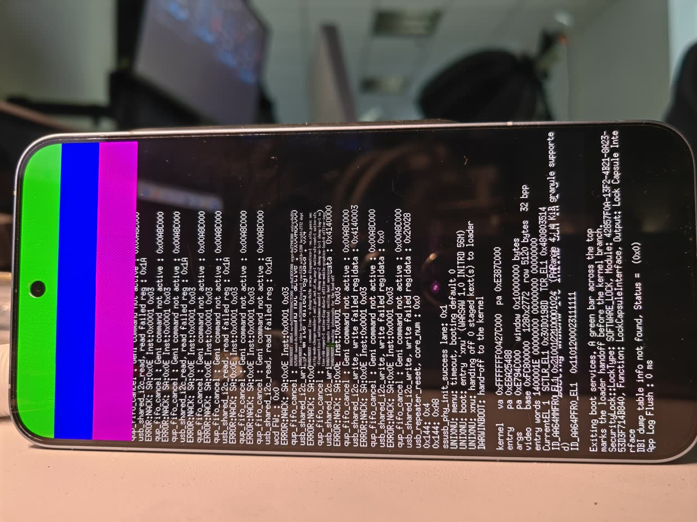
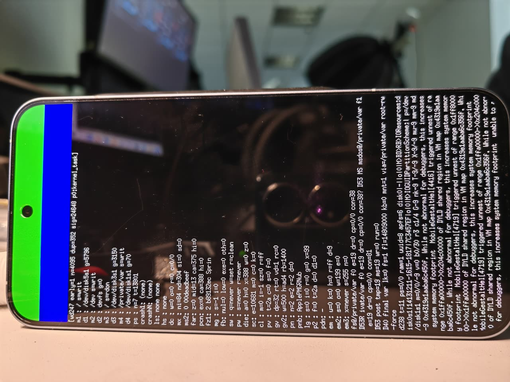
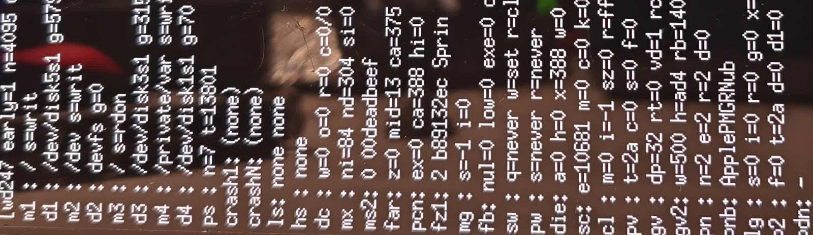

# 在骁龙 8 Elite 平板上启动源码编译的 iPadOS 17.7 XNU

English version: **[README.md](README.md)**

**九天，编号到 250 的上板轮次，每轮只动一个杠杆，一个杠杆实测约 51 分钟板时。**
下面所有数字都是量出来的，不是回忆出来的；同一个量在轮间漂过的，把两个值都写上。

**如果只看一段。**这一段里有三条结论是可以直接搬去任何设备仓的，其中一条还是对我们自己belief的纠正：

1. **造 Data 种子不需要 Mac。**XNU 自己的 APFS 驱动挂载了最后由 Linux `apfs-dkms` 0.3.18 写过的容器，
   读写挂载，并由预注册的容量格验证（第 3 节、第 6 节第 8 条）。
2. **墙不是尸体名单说的那堵。**干掉那个看起来卡住 launchd 的守护进程、以及给 `/var` 补上目录骨架，
   两次都没推动——两条完整的轴作为负结果关掉（第 3 节第 4 条、第 7 节）。
3. **那个 `abort()` 有机制，而且它不在文件系统里。**我们的镜像带着 IOReport 的**供给**那一半、
   没有**发布**那一半：没有 `AppleIOReport` 服务、没有 kext、没有设备树节点（第 7b 节）。
4. **以及那条纠正：**一台原装 Mac——一台参照 Darwin——一条命令就删掉了我们一条活着的假设，
   因为我们去内核注册表里找的那个类其实是用户态的类，在 macOS 的 `ioreg` 里同样出现 0 次（第 7a 节）。
   去用一台参照机，但先把版本差写下来：**形状可搬，版本特定期望不可搬。**

---

## 1. 我们这套东西是什么

| | |
| --- | --- |
| 板子 | 代号 `warsaw`，SoC **SM8750 / `qcom,sun`**（活的设备树里逐字写着 `Qualcomm … Warsaw based on SM8750`） |
| 系统版本 | **iPadOS 17.7.11 (21H461)**，内核集合源码自编，上游 pin `82b847c`（2026-11-04） |
| 启动方式 | `fastboot boot <bootimg>` 纯 RAM 启动。唯一真被写过的分区是 `misc`（BCB）；`boot`／`vendor_boot` 从没动过，随时把安卓原样开回来 |
| 构建机 | 普通 Ubuntu 26.04（内核 7.0.0-42），**整条链路上没有 Mac** |
| 控制台 | **没有可用的。**报表屏就是仪器（见第 4 节） |
| 一轮成本 | 构建 ≈1 分钟（实测两个 `.c` 走完 内核＋payload＋bootimg 共 63 秒，零 warning）＋板子 ≈50 分钟 |
| 记账 | 每轮一条账本（主账本现在 **1,457,027 B**）＋另一本调研账（**1,801,121 B**、152 个深挖小节）；**146 份轮次日志里有 `READ` 行**＝146 轮拿到完整读数 |

### 1.1 这块板子的详细情况（只写我们真量到的）

下面每一条都来自这块板子自己的 `board.toml`，以及从**这台机器本身** dump 下来的设备树——所以下面
这些地址是我们这块板的实测值，不是数据手册抄的。

| | |
| --- | --- |
| 机型 | **REDMI K90 Ultra**，`model_id = "M332BF"`，社区代号 `warsaw` |
| SoC | 骁龙 8 Elite ／ **SM8750**，家族 **`qcom,sun`**。活设备树里逐字写着 `model = "Qualcomm Technologies, Inc. Warsaw based on SM8750"`，`compatible = "qcom,sun-mtp qcom,sun qcom,sunp-mtp qcom,sunp qcom,mtp"` |
| CPU | `cpus` 下 8 个 `cpu@` 节点。八核的 `affinity-id` 每核都不一样 ⇒ 在这棵树上 SMP **必须跑单 pset** |
| 屏幕 | CSOT **"P12X"** 面板 ＋ **Novatek NT37801** 驱动 IC，**2772x1280**，单路 DSI、4 lane，**DSC 1.1**（bpc 10／bpp 8，slice 640x12）。活的设备节点叫 `qcom,mdss_dsi_p12x_42_02_0a_dsc_cmd` |
| 触控 | Goodix，`xiaomi,touch-spi`，挂在 QUP 串口子系统 `0xa88000`——**我们完全没驱动它** |
| 时基／GIC | 时基 19.2 MHz；GIC distributor `0x16000000`，redistributor 基址 `0x16080000`、stride `0x40000` |
| UFS | host `0x1d84000`，PHY `0x1d80000`（`qcom,ufs-phy-qmp-v4-sun`） |
| 存储布局 | 2026-11-04 用 `native-ufs-probe=10` 实量：**LUN 0** 上 `userdata` 这块 GPT 切片是 LBA `0x35b000 … 0x7aa93fa`、`lba_bytes = 4096` ⇒ **512.4 GB**。安卓侧是 `/dev/block/by-name/userdata → sda34`，SHNGROOT 清单和安卓自己启动用的 OS／SystemOS 窗口都在它上面 |
| XNU 拿到多少 | `dram_size = owned_memory_size = 0x10000000` ＝ **256 MiB** 自有内存；payload 卷叫 `WARSAWRAM`，`size_mib = 128` |
| 固件 | Mu-Silicium 的 **`uefi-dada`**（`firmware.config = "dada"`、`SILICIUM_UEFI.fd`）。我们是从厂商那颗 ABL 启来的：`fastboot getvar is-userspace` 答 `no`，所以 `fastboot boot` 走的是 ABL fastboot，不是 userspace 的 `fastbootd` |
| fastboot 序列号 | `b53c187d`，每条命令都带 `-s` 钉死——同一台宿主上同时还挂着一台安卓手机在 adb 上，「多设备不带 `-s`」本身就是第 6 节里的一条坑 |
| 仪器 | 一台华为 P50 Pro（`L2E0222401016332`）架在三脚架上，对着宕机报表屏拍照（第 4 节） |

## 2. 里程碑梯（不给百分比）

终点是「SpringBoard 进登录界面」，而其中两段我们**从没进过一步**，所以分母未知，后面的墙是肯定会
有、不是假设有。

| # | 阶段 | 状态 | 凭什么说它过了 |
| --- | --- | --- | --- |
| 1 | 内核 ＋ IOKit 初始化 | **2026-11-05 过** | 最早的真死法是 `IODeviceTreeSupport` 里一条 data abort；现在能走到 `bsd_init`、IOKit 起得来 |
| 2 | 可写 APFS 根 | **第 77 轮过** | 根卷读写挂载成功，`decmpfs` 压缩读通 |
| 3 | dyld 共享缓存 ＋ 签名／AMFI | **第 80 多到 150 多轮之间过** | 守护进程能从共享缓存 exec；`amfi_get_out_of_my_way=1`；AMFI 那行 `EPERM` 还在打，但不再挡路，而「去把 EPERM 打上补丁」这条臂在第 203-B 轮判死 |
| 4 | launchd 活着并把服务带活 | **第 200 轮（11-10 06:03）过** | 三十轮以来第一次墙动：`SpringBoard`、`watchdogd` 从尸体名单里消失，尸体数 **30 → 1** |
| 5 | 核心守护进程 | **当前这堵墙** | `PerfPowerService` 自己 `abort()`（SIGABRT），launchd 过不去。第 250 轮关掉了「种子里 `/var` 结构不完整是闸门」这一变体；7b 节那个机制是任何种子内容都补不出来的 |
| 6 | 图形／BackBoard | 未进 | 身后已经钉死一堵排在队里：`FrontBoardServices+0x1e2ec`＝「failed to find the main CADisplay」 |
| 7 | SpringBoard 界面 | 未进 | — |

## 3. 「成功」在我们这儿具体指什么

1. **四段真过了**（上表 1–4 行）。它们每一个在当时都是那堵墙，也都是靠「一次行为改动 ＋ 一次读数」
   关掉的，不是靠推理关掉的。
2. **造出了一台不会说谎的仪器**——用一台手机相机造的（第 4 节）。这是 150 轮之后所有事能做成的前提：
   现在我们能分辨「墙动了」和「读数抖」，200 轮之前分辨不了。
3. **在 Linux 上把 APFS 写入这条路打通了**（第 6 节第 8 条）。`--init-data` 的生成器要 `hdiutil`；现在
   我们能在 Linux 上造出一颗**带真实目录内容**的 Data 种子，并用苹果自己的 `apfsck` 在板外当裁判。
   而验证它那一轮跑出了更硬的结论，也是这段路我们最想告诉别的设备仓的一条：**XNU 自己的 APFS 驱动
   挂载了最后由 Linux `apfs-dkms` 0.3.18 写过的容器**（容量格 5 帧里 4 帧逐字读对、卷以读写挂上）。
   所以「造 Data 种子必须有 Mac」是假的；`hdiutil` 只是**跑上游那个生成器**才需要。
4. **两次做得干净的负结果**，各自关掉一整条轴：
   - **显示线**（第 214–236 轮，13 条臂：三门打通 → LEGACY 显示接通 → 平面发布到 `gIOServicePlane` →
     认出 provider 类名 → `publishOneLayer()`／`IOMFBNumLayers` → swap validation → 用户客户端选择子
     表 → powered 词 → NotFound 归因 → `dot-pitch`），第 237 轮做总负对照（IMGF 总闸关掉、源码不动）：
     **墙一根毛没动**。十三轮买到的权利，就是把这条假设删掉。
   - **杀掉那个我们以为是墙的守护进程**：第 247–249 轮我们干脆不让 `PerfPowerServices` 出生，墙原地
     不动——死亡普查还在同一个带里（228..278，而且历轮从未跌破 200）。所以那个看起来卡住 launchd 的
     进程是**症状**，不是墙。
5. **当前这条轴的数据面事实已经钉住，而且已经结案**：`/private/var` **挂了**、**可写**（`s=writ`）、
   背后是一颗真磁盘切片且**小于 1 GiB**（同屏另外两颗卷报 5 GiB／3 GiB），而且那颗切片就是我们那颗种子
   ——判据是容量格。「没挂」「只读」「是手机上真正的 Data 卷」三条全死。剩下那条「种子是空的」，
   第 250 轮验了并且关掉了（第 7 节）：**空，也不是这堵墙**。

## 4. 仪器（它决定了方法论）

上两张真照片，下面那些约束就不是抽象的了：

| | |
| --- | --- |
|  |  |
| **洪泛页**（宕机之前）：控制台尾环在循环。在对焦正常这一档里，这种页面是 4.68–5.31 MB，报表页是 4.66–4.72 MB——所以我们靠链日志里那一跳就能定位上屏时刻。 | **报表页**（宕机之后）：停车那 300 秒里拍下的固定报表块。屏已经滚到底，所以最后那几行之外根本不存在。 |
|  | |
| **我们真正发给识图端点的东西**：标准整块裁剪（`crop=2060:600:560:2030,scale=2450:710`，再放大）。它只盖到每行前约 26 格——再往右必须另开一条裁剪。 | |

没有控制台，唯一的通道是**尸表屏**：内核打印一段固定报表后停车 300 秒，才把板子还给 fastboot。
一台架在三脚架上的手机拍它，再由一个识图端点转写裁剪图。一轮的机械时间实测＝**发火 → 读回**
**50 分 39 秒／48 分 39 秒／52 分 49 秒**（三次复测）；报表页在 `el` ≈2704–2766 之间上屏，板子在
`el` 3040–3050 跳回 fastboot——确定性高到可以当钟用。

这套通道带来的约束，全部是量出来的：

- 屏上只渲染**最后约 20 行**、每行约 **28 个字符**——这是格式串／缓冲的限制，不是像素限制（在 4096
  宽的画面上文字实际排到 x≈4063）。承重的格子如果掉出底部或越过第 28 列，就等于不存在。为了把一个
  计数器挪进最后一行，我们专门花了一轮纯仪器轮（247）。
- 单个十进制格的转写噪声约 **20 %**，所以承重格必须**五帧里至少三帧逐字一致**，而且每轮开头先跑一行
  **已知答案的控制行**。（端点会把字形 `w` 系统性读成 `c`／`n`——这是字形级混淆，不算身份认错，控制行
  仍然算过。）
- 行的身份是按位置认的：行标签会跨帧互换，名字格读空的行会被整行丢掉。只有「它是第几行」可信。
- **改裁剪＝上次校准作废**：加／减一行会同时犯两个错（既吃掉上一行前缀，又漏掉最后一行）。
- 在对焦正常这一档里，**照片字节数能分页面类型**（洪泛页 vs 报表页），所以只看链日志那一跳就能定位
  上屏时刻，不必先问识图端点。
- **仪器本身就是故障源。**有两轮整轮丢掉，都丢在拍照链上而不是板子：一轮监视进程先死了，一轮 hop 早到
  409 秒导致四个拍照点全空。今天这台手机连续九个拍照点静默掉出 `adb`（USB 还在枚举），`adb kill-server`
  就好了——修它两行命令，救回了整段报表带。

## 5. 一轮怎么跑

1. 选定**恰好一个**行为杠杆（一个 boot arg、一个内核补丁，或一个 payload 输入）。
2. **发火之前把判据写死**在一个之后不再改的头文件里：闭集 A/B/C/D/E，只允许其中一个成为判据——其中
   必须包含「仪器坏了」这一支；再配一组必须逐字节稳定的金丝雀，和一个不通过就不许下判据的仪器自检。
3. **证明改动真的进了镜像**（第 6 节第 1 条）、`scp` 之后两端逐字重算 SHA-256、查
   `fastboot getvar max-download-size`，然后**只发一次火**。
4. 对着预注册的闭集读照片，写一条账：命中哪一支、每格读了什么、从此关掉什么。
5. 启动看门狗里那个**刻意留的 30 分钟延后闸门**会把启动按住，好让「闸门之后」的渲染真的上屏；它不是
   bug，是我们能拿到报表页的原因。

账本里我们用的诚实口径：不改变行为的轮次叫**探针**，不叫修复。

## 6. 真实吃掉时间的坑（每条都带数字）

**关于「证明镜像里是什么」**

1. **内核构建不可逐字节复现。**三次重编、源码零改动，得到 `54c3d67d…`、`52af15cd…`、`526415af…` 三个
   哈希。所以「内核前后一致」不能拿哈希当证据；我们改成在 `kernel.macho` 里做**格式串字面量普查** ＋
   被改源码的 mtime，并且禁止任何判据依赖一个绝对地址。这也是跨轮 `far`／`die` 漂移的一个候选解释。
2. 非登录 `ssh` 的 PATH 里没有 `strings`；内核的真身路径是 `…/warsaw/kernel/kernel.macho`，不是 payload
   里那份拷贝。

**关于 payload 与 Data 种子**

3. **Data 种子的 volume UUID 是编译进内核的**，而且 `scripts/unixnu/runtime.py` 遇到不一致**不是报错，
   是改写** `CONFIG_XNU_OWNER_DATA_VOLUME_UUID`。因为内核先编、payload 才读种子，所以「只换 payload 不换
   内核」必须把新种子的 volume UUID 钉成内核里已有的值。我们钉 `7F00D031-C00B-4368-A3FF-D4788A1323D6`。
4. **payload 阶段是「拒绝」不是「警告」**：staged 内容超过 `size_mib × 0.95` 直接报错
   （`scripts/unixnu/payload.py`）。一颗 72 MiB 的 Data 容器在 128 MiB 预算下测出 122 MiB staged 被拒，
   于是容器只剩 70 MiB——**容器大小是被天花板逼出来的，不是被假设选出来的**。我们接受这个尺寸变化，
   只因为它同时充当金丝雀：容量格两个数位必须一起翻，才能证明新种子真到了板上。
5. Data 挂载是按 **UUID 字符串逐字相等**去匹配编译期字面量（`drivers/RamBlock/NativeRamBlock.cpp` 里的
   `selectVolumeSeed()`）；不匹配就是 `ENOENT`，于是根本没有 `/private/var`。**盘上 UUID 的字节序应当去
   量活种子，而不是推理**——我们曾经把一个错的字节序带进了一次构建，现在构建脚本会在切出来的容器裸字节
   与活种子不一致时直接中止。
6. `ls … | tail` 是**按字母序、不是按时间序**：我们因此把一份全新的 `payload.json` 当成过期文件读。
7. `ssh 'cd dir && nohup ./build.sh > log 2>&1 & sleep 2; tail log'`——这里的 `&` 会把整条 `cd &&` 列表
   一起丢后台，于是 `tail` 在家目录跑、假报「log 不存在」，而手一抖重试就变成**两份并发构建**。

**关于 Linux 构建机**

8. `--init-data` 的生成器要 `hdiutil`（macOS 独占）。这台 Ubuntu 的内核配置里没有 APFS，dpkg 前端锁已经
   卡了约 42 小时，`mkfs.hfsplus`／`apfs.h`／`mount_hfs` 一样都没有——于是我们 `dpkg-deb -x` 拆开
   `apfs-dkms`、树外编译、`insmod` 进去。两个坑：写入必须带挂载选项 **`readwrite`**（不带就静默只读挂载，
   并警告「experimental writes disabled to avoid data loss」）；这个 `mkapfs` 版本把容器超级块写在
   容器＋`0x20`，所以沿用的 32 字节旋转会让镜像过不了 `apfsck`、也挂不上。
9. **上游的主机检查器在这台机器上链接不了。**该发行版的 clang 21 不带 compiler-rt 静态库，凡是硬编码
   `-fsanitize=address,undefined` 的都能编译、然后链接失败。补上桩之后
   `check-native-data-mount-path.py` 能对我们打过补丁的 `native_owner_data_prepare()` 跑出
   `PASS … 8 … refusal paths`（9/9 场景）。它五个兄弟里有两个先得修仓库根路径（`parents[1]` ＋一个
   `.cache` 软链），另外四个是 QEMU/HVF 产物闸门，在 Linux 主机上根本跑不了。价值在于：它证明挂载决策
   **对内容不敏感**，所以「容器挂上了」这种读数永远不能算成种子内容的功劳。
10. 网络拓扑：GitHub REST API 从构建机可达（200，约 1.3 秒），从驱动板子那台 Windows 不可达。另外
    `drivers/*` 是**子模块**，所以在主仓按路径列 commit 只会看到 pin 升级——真改动在驱动自己的仓里。

**关于读屏**

11. **绝对数值不是证据。**`die x` 在行为完全没变的轮次里读到过 330／401／244／253／337。只有「归零」
    「恒等」「纹丝不动」可行动，所以我们把每条治疗判据都写成恒等式而不是阈值。
12. 「逻辑上不可能的读数」多半是把两行口径不同的格子读成同一口径（两个都显示成 `z` 的计数，一个含义是
    `FAR < 0x1000`、另一个是 `FAR == 0`）。宣布恒等式破了之前先回源码看那个 `if`。相关的一条坑：**一行
    的含义是它的实参表，不是它的标签**——有一行四个格子来自一条五个计数器的链，于是从这行拼出来的每条
    恒等式都悄悄少了一项。
13. 让端点回答**闭集短词**，别让它自由发挥。糊帧上同一张图能把数值绑到错的行，自由文本还会跨轮换措辞。

**关于那台参照机**

14. **局域网里的机器按指纹认，别按 IP 认。**我们这段局域网既不答反向 DNS 也不答 NetBIOS，而地址是会换
    主人的：现在这台 Mac mini 用的那个地址，之前属于一台 Linux 机。我们改成按端口形状挑机器——不带发行版
    后缀的 `OpenSSH_10.3` banner ＋ 5000／7000／3283 开着且没有应用签名＝macOS；某个应用端口从「以前会答」
    变成「不应答」＝那台机器没了或者搬走了。
15. 参照 Darwin 纠正的是**形状**，不是**版本**（7a 节）。用它之前必须把版本差写死在纸上（Darwin 27 vs 我们
    payload 的 Darwin 23），否则每一次 macOS 读数都会诱惑我们去「修」一个 iOS 17 根本不在乎的东西。

## 7. 第 250 轮：种子那一发，以及它关掉了什么

唯一的杠杆是 Data 种子。旧种子＝一颗 `mkapfs` 格式化出来的空容器（68,190,208 B，**非零字节只有 955 个**；
文件系统树里只有 APFS 自己造的合成名字，也就是零真实内容）。新种子＝70 MiB 容器，里面通过真正的 APFS
写入器，把 `044-76040-038.dmg` 的初始 `private/var` **目录骨架**拷了进去：**176 个目录、1 个符号链接、
0 个常规文件**（外加上游 fixture 清单，以及两个假设目标 `mobile/Library/BatteryLife`（Powerlog 要的）
和 `db/timezone`），卷根 `0755`，`tmp` 与 `run` `1777`，除 `mobile` 归 `501:501` 外全部 `0:0`。

故意不放的：抽出来的 IPSW 文件里 **88 %（4,270 个中的 3,740 个）带 `UF_COMPRESSED`**，它们 7z 解出来的
字节是苹果压缩过的资源块而不是内容；而且全新安装的 `/var` 本来就是空的，SQLite 会自己建库。所以这颗种子
是「只要结构、不夹带谎言」。`apfsck` 在三个阶段全部返回 0，Linux 驱动把切出来的容器只读重挂后显示
176 目录 ＋ 1 链接且权限正确——这是板外能拿到的最强前置证据。内核与 boot-arg 零改动。

我们明写出来而没有藏起来的 confound：容器同时从 64 涨到 70 MiB，所以如果结构变了，不能全归给内容。
`staged_system_apps`（6,575 个目录）省掉是安全的，因为 `native_staged_apps_prepare()` 第一行就被
`sheng-staged-apps=1` 门住，而我们不传这个 arg。

**结案：分支 B——Data 种子这条轴的「结构」变体关门。** 09:49:07 发火、`READ el=3044`。自检全绿：新容量格
**5 帧里 4 帧逐字**读对，挂载那行照旧是可写。C 分支的三条触发器一条都不在——跳回落点仍在 3040..3050 带内、
洪泛页／报表页字节带没跳、上屏仍在 2706..2760、尸表仍是两行。所以缺的那套 `/var` 结构**不是**这堵墙的料。

关于这个结案的两条诚实保留。第一，它靠的是「C 的触发器全缺席」，**不是**靠重读死讯行——那些格子跨帧会
读出变了的信号编号和变了进程名，我们把它当通道噪声，不当数据。第二，我们从第 247 轮就该还自己的那个白送
格子，这一轮仍然没能读回来；**读数通道的缺口不能记在种子头上**，这条账继续欠着。

## 7a. 一台原装 Mac 教我们的事，以及它把我们纠正的地方

局域网里有一台 Mac mini（macOS 27.0.1／26A434、Darwin 27、arm64），它是一台**参照 Darwin**——同一支 XNU
血统，但比我们启的 iPadOS 17.7.11（Darwin 23）**晚四代**，所以**形状可以抄、版本特定期望不能抄**。
我们把它当事实核查机用，它纠正了四处：

| 我们原本的假设 | 原装 macOS 上的答案 | 后果 |
| --- | --- | --- |
| Powerlog 的家在 `/var/mobile/Library/BatteryLife`（我们种子瞄的就是这个） | 在 `db/powerlog/Library/BatteryLife/CurrentPowerlog.PLSQL`——在 `/var/db` 下，不在 `/var/mobile/Library` | 下一颗种子要种的是 `db/powerlog` 那条路，不是我们种的那条 |
| 有 `/private/var/folders` 这个目录就够了 | 真身是 `zz/zyxvpxvq6csfxvn_n0000000000000/{0,C,T,X}`，`C`／`T` 是 `0700`，外加每用户一个桶 | 我们那个 `folders` 是个空目录＝我们自己造的形状 |
| `/private/var/run` 给 `1777`（`make-data-seed.py` 自己就是这么 chmod `tmp` 的） | `0775`、属组 `wheel`、不带 sticky | 这个权限是从上游生成器抄来的，不是从 Darwin 来的 |
| 后面那堵图形墙：发 `IOMFBNumLayers` 时给 `MaxNumLayers=1` | 真属性是 `{"FullFrameRequired"=0,"MaxNumLayers"=3}` | 原装系统标三层的场所，我们只发了一层 |

它还直接**删掉**了我们一条假设：原装 macOS 的 `ioreg` 里 `CADisplay` 出现 **0 次**——那是用户态的类——
所以「内核注册表里没有 CADisplay」从来就不是「缺一个内核对象」的证据。另外它把 `PerfPowerServices` 真正的
launchd 合同交给了我们（`KeepAlive`、`EnableTransactions`、`ProcessType=Adaptive`、两条 MachServices），
此前这些我们一直在猜。

顺带说清 Mac **替不了**的两件事：iOS 特异的 `/var` 属主与启动序，只有 iOS 17.x 的真机能给（macOS 是另一个
`/var`）；而下一节那个缺失的 IOReport provider，Mac 和 iPhone 都不负责补。

## 7b. 零板时在我们自己内核里查到的那条不对称

`PerfPowerServices` 就是 IOReport 的用户态订阅者。把我们出货的 `kernel.macho` 和三张镜像全 grep 一遍，
画出来是一个单边的样子：

- 内核：供给侧字符串 **310 条**（`IOReporter`、`IOReportChannel*`、`IOReportLegend`、`handleSwapPrepare`…），
  而 `io_report`、`AppleIOReport`、`IOReportSubscribe` 全 **0**；
- `payload.img`、`boot.img`、`userdata-root.img`：`AppleIOReport` 与 `com.apple.driver.AppleIOReport`
  **三张全 0**；
- 从这台手机 dump 下来的活设备树：`ioreport`、`report-channel`、`energy` **0 命中**。

也就是说 IOReport 的**供给那一半编译进来了、发布那一半整张镜像上不存在**。这给那个守护进程的 `abort()`
提供了一个**任何种子内容都补不出来**的机制解释——与第 250 轮的负结果正好对得上。诚实标注：用户态那一半
还没钉死——`libIOReport` 确实在共享缓存里，但 `AppleIOReport`、`IOReportSubscribe` 两个字符串在那儿 0 命中，
因为带 linkedit 与符号表的那几个分片是我们那套抽取解不开的。要把这半补上，需要一台活的 iOS 设备，不是 Mac。

## 8. 这一周在生态里查到的东西

- **同代 peer 里没有谁越过这堵墙。**离得最近的那台（同 OS build 21H461、同 SM8750 家族，
  `donyanchen/UniXNU-piano`）还停在 UEFI 阶段的 payload 发布——它提交的三份报告记录了 `oem ramdisk`
  从 `cannot publish the payload` 变成 `OKAY`、菜单里出现 `xnu` 条目；XNU 日志一条都还没有。跑得最远的
  那台（同一块平板，`lenzhang/UniXNU-xiaomipad8pro`）跑的是 **macOS 27.3**，root 和 Data 在真 UFS 上、
  Adreno 830 已经在合成桌面——那是另一条 OS 线。所以**没有配方可抄**。
- **同步上游的价码（实测，不是猜）。**那两笔「发布持久化 APFS 根容器」（`1fbf7a4` ＋71 行，
  `00a6e5d` ＋2/−71 行）在 `NativeRamBlock.cpp` 里**净零**，既不修也不坏我们的挂载路；
  `drivers/RamBlock` 的 boot-arg 改名只碰 `sheng-data-reset`，而我们从来不传。真拦路虎在核心仓：
  `scripts/unixnu/payload.py::check_native_root()` 在我们 pin 上匹配 `sheng-pmgr=2`，到 `main` 上要求
  `pmgr=2`，而且同一批还动了 `build-xnu-4k-baseline.sh`、`runtime.py`、`userdata.py`。我这边的结论＝
  **同步必须自己占一轮板，它不是一次免费 rebase**。
- APFS 的「原生工具」造容器那条工作是 macOS 侧（基于 `hdiutil`）的，所以对不用 Mac 的人，我们这条 Linux
  路仍然是必需的。

## 9. 想请维护者回答的六个问题

1. **`sheng-` 前缀去掉这件事，是打算让设备仓破坏性升级吗？**我们传 `sheng-pmgr=2`；pin 上的
   `check_native_root()` 正好认这个串，`main` 上要求 `pmgr=2`。同步之后这是构建期报错——这很好（够响），
   但需要一句迁移说明，最好让旧名字再兼容一个版本。
2. **`size_mib × 0.95` 这个 payload 天花板是刻意设计成「拒绝」的吗？**它悄悄限制了 Data 种子能长多大，
   我们的 70 MiB 容器就是被它逼出来的。如果官方出路是 `packed_data_ramdisk` ＋ `fastboot stage` ＋
   `oem ramdisk`（SM8750 那台 peer 就是这么做的，因为厂商 ABL 拒收 160 MiB ramdisk），那 `oem ramdisk`
   是 Mu-Silicium 专有命令，还是对厂商 ABL 也成立？
3. **Linux 侧的 Data 种子路子上游要不要？**我们这套是：树外编 `apfs-dkms`、带 `readwrite` 挂载、通过挂载点
   填内容、用 `apfsck` 验收、并且把 volume UUID 钉住好让 `runtime.py` 不必回头改内核配置。效果＝把
   `hdiutil` 这个前提从非 Mac 构建里去掉。
4. **在我们这个 pin 上，内核构建不可逐字节复现是预期的吗？**如果成因是 build-id 或 `__DATA` 里的时间戳之类，
   那么一个类似 `--reproducible` 的开关能让设备仓继续保留「这一轮内核可证明没变」这条便宜的断言——现在
   我们得靠格式串普查来代替它。
5. **非苹果 SoC 上 IOReport 打算怎么满足？**我们的镜像里只有供给那一半（`kernel.macho` 里 310 条
   `IOReporter` 一族），发布那一半根本没有：内核里没有 `AppleIOReport` 服务，`payload.img`／`boot.img`／
   `userdata-root.img` 里没有 `com.apple.driver.AppleIOReport`，设备树里也没节点（7b 节）。而
   `PerfPowerServices`——用户态那个订阅者——会 `abort()`，且它崩的方式不是种子内容能影响的。发布一个
   IOReport provider 是设备仓该干的活，还是官方答案就是「别让那个守护进程起」？
6. **首次安装的 Data 种子有没有一份「期望 `/var` 清单」可以对照？**我们那份是从 IPSW 拼出来的，然后被一台
   原装 macOS 在四处纠正（7a 节：Powerlog 真正走哪条路、`folders` 的桶形状、`/var/run` 的权限、
   `IOMFBNumLayers` 的取值）。一份写进仓库的「种子必须有哪些路径＋属主＋权限」清单，能让每个设备仓省掉
   我们这一整轮猜——而我们的这一轮，回来是负的。

每轮一条的账本（1.45 MB；每轮含预注册闭集、金丝雀、逐格读数、判据）可以要就给；单轮的预注册头文件约
7 KB，大概率是第一眼更值得看的东西。
