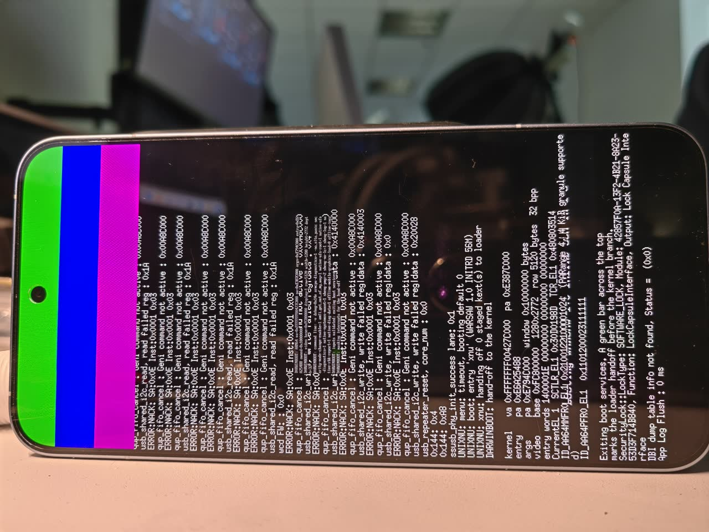
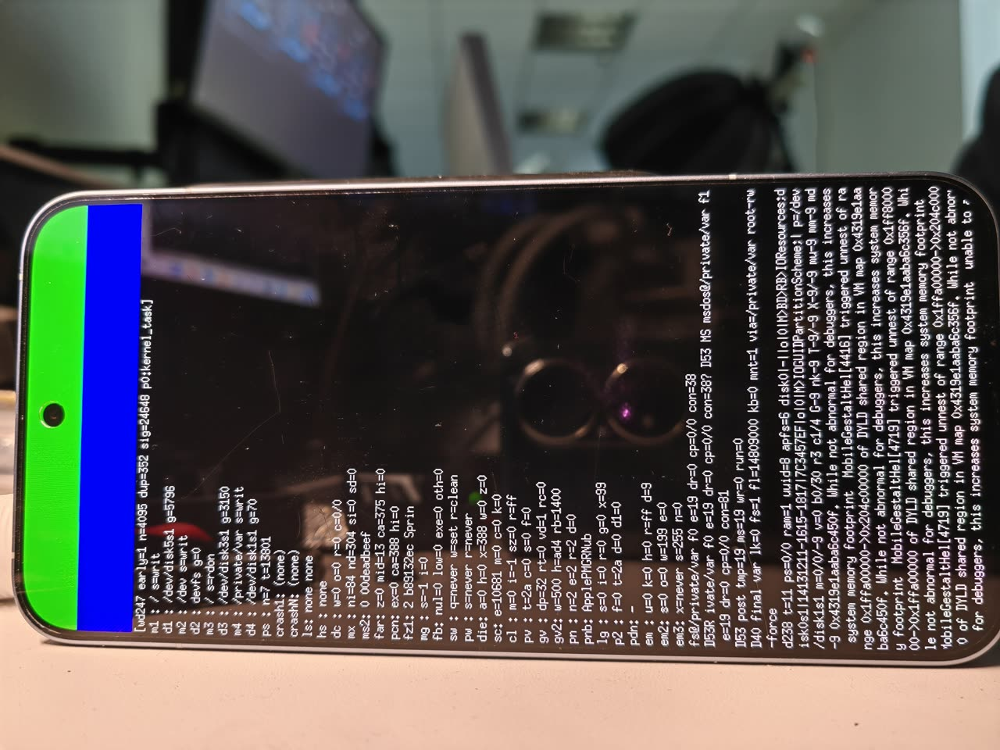
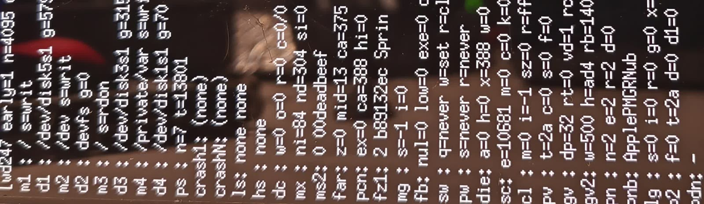

# 在骁龙 8 Elite 平板上启动源码编译的 iPadOS 17.7 XNU

English version: **[README.md](README.md)**

**十四天，编号到 315 的上板轮次，每轮只改一个行为，一个改动实测约 51 分钟板时。**
下面所有数字都是量出来的，不是回忆出来的；同一个量在轮间变过的，把两个值都写上。文末第 10 节是
完整的借鉴清单（作者＋地址＋版本）。

**四条最值得看的结论。**三条可以直接搬到任何设备仓，第四条是对我们自己一个判断的纠正：

1. **造 Data 种子不需要 Mac。**XNU 自己的 APFS 驱动挂载了最后由 Linux `apfs-dkms` 0.3.18 写入的容器，
   读写挂载，并由预先注册的容量格验证（第 3 节第 3 条、第 6 节第 8 条）。
2. **看起来卡住 launchd 的那个守护进程不是原因。**不让它启动、以及给 `/var` 补上目录结构，两次都没有
   改变启动结果——两类原因被实验排除（第 3 节第 4 条、第 7 节）。
3. **那个 `abort()` 有明确机制，而且它不在文件系统里。**我们的镜像里有 IOReport 的 **provider** 那一半、
   没有 **publisher** 那一半：没有 `AppleIOReport` 服务、没有 kext、没有设备树节点（第 7b 节）。
4. **纠正的那条：**在一台原装 Mac 上跑一条命令，就排除了一条我们已经执行了一周的假设——因为我们去内核
   注册表里找的那个类是用户态的类，在 macOS 的内核注册表里同样出现 0 次（第 7a 节）。可以用一台原装 Mac
   当参照系统，但要先记下操作系统版本差：**目录结构和属性名可以跨版本搬，版本相关的行为不能搬。**

### 本文用词

| 词 | 本文里的意思 |
| --- | --- |
| 一轮 | 一次构建 ＋ 板子上跑一次 ＋ 读一次结果 |
| 发火 | 用 `fastboot boot` 把编好的 `boot.img` 在板子上跑一次 |
| Data 种子 | 我们交给 XNU 当作 Data 卷的那颗磁盘镜像 |
| 报表页 | XNU 宕机时打印的那段固定报表；它在屏上停留的秒数由 panic code 决定（四档，见 7d 第 2 条） |
| 控制台刷屏页 | 宕机之前的那一屏，画面里是不断重复的控制台输出 |
| 对照值 | 期望值我们已经知道的格子，用来检验读数通道本身 |
| 到达见证 | 用来证明「本轮改的东西真的进了板子」的几格；不逐字命中就不许判疗效 |
| 停留（dwell） | `跳回 el − 渲染帧 el`；因为停留时长由 panic code 定值，它是一把不靠读图的尺子 |
| 跳回 | 宕机之后板子重新回到 fastboot 的那个时刻 |
| provider／publisher | XNU 的 IOReport 机制的两半（苹果自己的命名） |

### 这个仓库里有什么

| 路径 | |
| --- | --- |
| `README.md`、`README.zh.md` | 本报告，中英各一份 |
| `FLASHING.md`、`FLASHING.zh.md` | 一轮在设备上真正写了什么、发火前的预检、实测时间，以及 Data 种子的纯 Linux 做法 |
| `scripts/` | 一轮的构建脚本、两轮的发火脚本、拍照脚本、APFS volume UUID 读取脚本——全部逐字复制，绝对路径也照抄，所以它们是存档记录，不是一套能直接跑的套件 |
| `flash/misc-bcb-fb.img` | 每轮写进 `misc` 的那 2,048 字节 BCB |
| `examples/header251.txt` | 一份「发火前就写死」的判据表 |
| `figures/` | 两张宕机屏照片 ＋ 交给读图端点的那张裁剪（第 4 节） |
| `manifest-sha256.txt` | 本仓库发布物的 SHA-256，加上留在构建机上没发出去的那几颗二进制（`kernel.macho`／bootimg 等）的哈希 |
| Release `v250` | `data-seed250-gpt70.img.gz`，87,005 字节——`gunzip` 之后就是第 7 节那一轮用的 Data 种子，由 `FLASHING.md` 第 6 节的纯 Linux 做法造出来。资产之所以是 gzip 过的，是因为上传控件拒绝 `.img` 后缀 |

没发出来的：前 250 轮的 234 颗中间 bootimg（共 29 GB；单颗 136,474,624 字节，超过 git 托管方
单文件 100 MB 限制），以及 9,382,658,048 字节的 `userdata` 备份。这几样在
`manifest-sha256.txt` 里给哈希，在 `FLASHING.md` 第 5 节里给当时产出它们的命令——附带一条限制：
内核构建不是字节可复现的，所以哈希标识的是一颗二进制，不代表「源码到二进制」的可复现保证。

**11-13 之后的 65 轮（第 251–315 轮）。**这些轮的中间 bootimg 同样没有发布，仍留在构建机上；它们的
照片、发火前写死的判据表（`hdrNNN.txt`，发火后只许追加）和结案记录在同一个任务目录里，本报告只把结论
搬过来（第 7d 节）。这条主线已于 **2026-11-17 暂停**（不是放弃：同一块板子、同一套流程，以后继续），
暂停前把不可重生的部分备份成两份实物——构建机 `/home/dong/backup/warsaw-20261117/`（12 MB，62 行清单，
含 20 颗子模块的差异与 127 MB 内核工作树的二进制差异），以及 Windows 侧 112,635,500 字节的文本快照加
5,104,642 字节的记录快照（两份都回拷进了构建机的备份目录）。**备份之后设备侧零写入**：主线暂停期间的
第一批实验全部在构建机上完成，板子只等一次纯读的分区表快照。

---

## 1. 我们这套东西是什么

| | |
| --- | --- |
| 板子 | 代号 `warsaw`，SoC **SM8750 / `qcom,sun`**（活的设备树里逐字写着 `Qualcomm … Warsaw based on SM8750`） |
| 系统版本 | **iPadOS 17.7.11 (21H461)**，内核集合源码自编，上游 pin `82b847c`（2026-11-04） |
| 启动方式 | `fastboot boot <bootimg>` 纯 RAM 启动。真被写过的分区＝`misc`（BCB，多数轮次）＋ `userdata`（1 次，2026-11-07，动手前先把整块 `userdata` dump 成 9,382,658,048 B 当备份）；`boot`／`vendor_boot` 与其余 A/B 分区从没动过，用 `fastboot erase misc` 清掉 BCB 就能把安卓原样开回来 |
| 构建机 | 普通 Ubuntu 26.04（内核 7.0.0-42），**整条链路上没有 Mac** |
| 控制台 | **没有可用的。**宕机报表屏是唯一的输出通道（见第 4 节） |
| 一轮成本 | 构建 ≈1 分钟（实测两个 `.c` 走完 内核＋payload＋bootimg 共 63 秒，零 warning）＋板子 ≈50 分钟 |
| 记账 | 每轮一条账本（主账本现在 **1,457,027 B**）＋另一本调研账（**1,801,121 B**、152 个深挖小节）；**146 份轮次日志里有 `READ` 行**＝146 轮拿到完整读数 |

### 1.1 这块板子的详细情况（只写我们真量到的）

下面每一条都来自这块板子自己的 `board.toml`，以及从**这块板子本身** dump 下来的设备树——所以下面这些
地址是我们这块板的实测值，不是从数据手册抄的。

| | |
| --- | --- |
| 机型 | **REDMI K90 Ultra**，`model_id = "M332BF"`，社区代号 `warsaw` |
| SoC | 骁龙 8 Elite ／ **SM8750**，家族 **`qcom,sun`**。活设备树里逐字写着 `model = "Qualcomm Technologies, Inc. Warsaw based on SM8750"`，`compatible = "qcom,sun-mtp qcom,sun qcom,sunp-mtp qcom,sunp qcom,mtp"` |
| CPU | `cpus` 下 8 个 `cpu@` 节点。八核的 `affinity-id` 每核都不一样 ⇒ 在这棵树上 SMP **必须跑单 pset** |
| 屏幕 | CSOT **"P12X"** 面板 ＋ **Novatek NT37801** 驱动 IC，**2772x1280**，单路 DSI、4 lane，**DSC 1.1**（bpc 10／bpp 8，slice 640x12）。活的设备节点叫 `qcom,mdss_dsi_p12x_42_02_0a_dsc_cmd` |
| 触控 | Goodix，`xiaomi,touch-spi`，挂在 QUP 串口子系统 `0xa88000`——**我们没有它的驱动** |
| 时基／GIC | 时基 19.2 MHz；GIC distributor `0x16000000`，redistributor 基址 `0x16080000`、stride `0x40000` |
| UFS | host `0x1d84000`，PHY `0x1d80000`（`qcom,ufs-phy-qmp-v4-sun`） |
| 存储布局 | 2026-11-04 用 `native-ufs-probe=10` 实量：**LUN 0** 上 `userdata` 这块 GPT 切片是 LBA `0x35b000 … 0x7aa93fa`、`lba_bytes = 4096` ⇒ **512.4 GB**。安卓侧是 `/dev/block/by-name/userdata → sda34`，SHNGROOT 清单和安卓自己启动用的 OS／SystemOS 分区都在它上面 |
| XNU 被告知它拥有多少 | `dram_size = owned_memory_size = 0x10000000` ＝ **256 MiB** 自有内存；payload 卷叫 `WARSAWRAM`，`size_mib = 128` |
| 固件 | Mu-Silicium 的 **`uefi-dada`**（`firmware.config = "dada"`、`SILICIUM_UEFI.fd`）。我们是从厂商那颗 ABL 启来的：`fastboot getvar is-userspace` 答 `no`，所以 `fastboot boot` 走的是 ABL fastboot，不是 userspace 的 `fastbootd` |
| fastboot 序列号 | `b53c187d`，每条命令都用 `-s` 指定——同一台宿主上同时还挂着一台安卓手机在 adb 上，「多设备不带 `-s`」本身就是第 6 节里记录的一个问题 |
| 相机 | 一台华为 P50 Pro（`L2E0222401016332`）架在三脚架上，对着宕机报表屏拍照（第 4 节） |

## 2. 阶段（不给百分比）

目标是「SpringBoard 进登录界面」。其中有两段我们**一步都没进过**，所以分母未知；第 7 段之后一定还有
我们现在看不到的阻塞点。

| # | 阶段 | 状态 | 凭什么说它过了 |
| --- | --- | --- | --- |
| 1 | 内核 ＋ IOKit 初始化 | **2026-11-05 过** | 最早的真实故障是 `IODeviceTreeSupport` 里一条 data abort；现在能走到 `bsd_init`、IOKit 起得来 |
| 2 | 可写 APFS 根 | **第 77 轮过** | 根卷读写挂载成功，`decmpfs` 压缩读通 |
| 3 | dyld 共享缓存 ＋ 签名／AMFI | **第 80 多到 150 多轮之间过** | 守护进程能从共享缓存 exec；`amfi_get_out_of_my_way=1`；AMFI 那行 `EPERM` 还在打，但不再阻止启动；「去把 EPERM 打上补丁」这个改动在第 203-B 轮判定无效 |
| 4 | launchd 存活并且能把服务拉起来 | **第 200 轮（11-10 06:03）过** | 三十轮以来第一次结果变化：`SpringBoard`、`watchdogd` 不再出现在死进程表里，死进程数 **30 → 1** |
| 5 | 核心守护进程 | **今天启动停在这里** | `PerfPowerService` 自己 `abort()`（SIGABRT），launchd 过不去。第 250 轮排除了「种子里 `/var` 目录结构不完整是原因」这个变体；7b 节那个机制是任何种子内容都补不出来的 |
| 6 | 图形／BackBoard | 未进 | 已经定位、排在待办里的阻塞点有一个：`FrontBoardServices+0x1e2ec`＝「failed to find the main CADisplay」 |
| 7 | SpringBoard 界面 | 未进 | — |

## 3. 在我们这儿，「有进展」具体指什么

1. **四段过了**（上表 1–4 行）。它们每一个在当时都是那个阻塞点，也都是靠「一次行为改动 ＋ 一次读数」
   确认通过的，不是靠推理。
2. **一条误差范围量清楚的读数通道**（第 4 节）。这是 150 轮之后所有事能做成的前提：现在我们能分辨
   「启动结果变了」和「读数抖」，200 轮之前分辨不了。
3. **在 Linux 上把 APFS 写入这条路打通了**（第 6 节第 8 条）。`--init-data` 的生成器要 `hdiutil`；现在
   我们能在 Linux 上造出一颗**带真实目录内容**的 Data 种子，并用苹果自己的 `apfsck` 在板外做验证。
   而验证它那一轮得到了更强的结论，也是这段工作里我们最想告诉别的设备仓的一条：**XNU 自己的 APFS 驱动
   挂载了最后由 Linux `apfs-dkms` 0.3.18 写入的容器**（容量格 5 帧里 4 帧逐字读对、卷以读写挂上）。
   所以「造 Data 种子必须有 Mac」是假的；`hdiutil` 只是**跑上游那个生成器**才需要。
4. **两个负结果，各自排除掉一整类原因：**
   - **显示**（第 214–236 轮，13 个改动：三个 boot arg → LEGACY 显示路径接通 → 平面发布到
     `gIOServicePlane` → provider 类名 → `publishOneLayer()`／`IOMFBNumLayers` → swap validation →
     用户客户端选择子表 → powered 词 → NotFound 归因 → `dot-pitch`），第 237 轮做完整负对照（IMGF 总
     开关关掉、源码不动）：**这 13 轮加上对照轮，启动结果完全相同。**做完这些轮，我们把「显示状态和
     启动停在哪一段有关」这条假设删掉了。
   - **我们原以为是原因的那个守护进程**：第 247–249 轮我们干脆不让 `PerfPowerServices` 启动，启动停在
     完全相同的位置——死进程数还在同一个带里（228..278，而且历轮从未跌破 200）。所以那个看起来卡住
     launchd 的进程是**结果，不是原因**。
5. **Data 卷相关的事实已经确认，结论也有了**：`/private/var` **挂了**、**可写**（`s=writ`）、背后是一颗
   真磁盘切片且**小于 1 GiB**（同屏另外两颗卷报 5 GiB／3 GiB），而且那颗切片就是我们那颗种子——判据是
   容量格。「没挂」「只读」「是手机上真正的 Data 卷」这三条全部排除。剩下那条「种子是空的」，第 250 轮
   验了并且排除了（第 7 节）：**`/var` 是空的也不是原因**。

## 4. 读数通道（它决定了方法论）

上两张真照片，下面那些约束就不是抽象的了：

| | |
| --- | --- |
|  |  |
| **控制台刷屏页**（宕机之前）：控制台输出在循环。在对焦正常这一档里，这种页面是 4.68–5.31 MB，报表页是 4.66–4.72 MB——所以我们只看链日志里的那一跳，就能定位报表页被画出来的时刻。 | **报表页**（宕机之后）：板子停车那 300 秒里拍下的固定报表块。屏已经滚到底，所以最后那几行之外的内容根本不存在。 |
|  | |
| **我们真正发给识图端点的东西**：标准整块裁剪（`crop=2060:600:560:2030,scale=2450:710`，再放大）。它只盖到每行前约 26 格——再往右必须另开一条裁剪。 | |

没有控制台，唯一的输出通道是**宕机报表屏**：内核打印一段固定报表后停车 300 秒，才把板子还给 fastboot。
一台架在三脚架上的手机拍它，再由一个识图端点转写裁剪图。一轮的机械时间实测＝**发火 → 读回**
**50 分 39 秒／48 分 39 秒／52 分 49 秒**（三次复测）；报表页在 `el` ≈2704–2766 之间被画到屏上，板子在
`el` 3040–3050 回到 fastboot——重复性高到可以当钟用。

这套通道带来的约束，全部是量出来的：

- 屏上只渲染**最后约 20 行**、每行约 **28 个字符**——这是格式串／缓冲的限制，不是像素限制（在 4096
  宽的画面上文字实际排到 x≈4063）。承重的格子如果掉出底部或越过第 28 列，就等于不存在。为了把一个
  计数器挪进最后一行，我们专门花了一轮纯仪器轮（247）。
- 单个十进制格的转写噪声约 **20 %**，所以承重格必须**五帧里至少三帧逐字一致**，而且每轮开头先跑一行
  **已知答案的对照行**。（端点会把字形 `w` 系统性读成 `c`／`n`——这是字形级混淆，不算身份认错，对照行
  仍然算过。）
- 行的身份是按位置认的：行标签会跨帧互换，名字格读空的行会被整行丢掉。只有「它是第几行」可信。
- **改裁剪＝上次校准作废**：加／减一行会同时犯两个错（既吃掉上一行前缀，又漏掉最后一行）。
- 在对焦正常这一档里，**照片字节数能分页面类型**（控制台刷屏页 vs 报表页），所以只看链日志那一跳就能
  定位报表页被画出来的时刻，不必先问识图端点。
- **拍照链本身也会坏。**有两轮整轮丢掉，都丢在拍照链上而不是板子：一轮监视进程先退出，一轮板子早 409 秒
  回到 fastboot、导致四个拍照点全空。今天这台手机连续九个拍照点在 `adb` 上没响应（USB 还在枚举），
  `adb kill-server` 就好了——修它两行命令，否则这一轮的报表照片全丢。

## 5. 一轮怎么跑

1. 选定**恰好一个**行为改动（一个 boot arg、一个内核补丁，或一个 payload 输入）。
2. **发火之前把判据写死**在一个之后不再改的头文件里：闭集 A/B/C/D/E，只允许其中一个成为判据——其中
   必须包含「仪器坏了」这一支；再配一组必须逐字节稳定的对照值，和一个不通过就不许下判据的仪器自检。
3. **证明改动真的进了镜像**（第 6 节第 1 条）、`scp` 之后两端逐字重算 SHA-256、查
   `fastboot getvar max-download-size`，然后**只发一次火**。
4. 对着预注册的闭集读照片，写一条账：命中哪一支、每格读了什么、从此排除掉什么。
5. 启动看门狗里那个**刻意留的 30 分钟延时会把启动按住**，好让延时之后的渲染真的上屏；它不是 bug，
   是我们能拿到报表页的原因。

账本里我们用的口径：不改变行为的轮次叫**测量轮**，不叫修复。

## 6. 真实吃掉时间的问题（每条都带数字）

**关于「证明镜像里是什么」**

1. **内核构建不可逐字节复现。**三次重编、源码零改动，得到 `54c3d67d…`、`52af15cd…`、`526415af…` 三个
   哈希。所以「内核前后一致」不能拿哈希当证据；我们改成在 `kernel.macho` 里做**格式串字面量普查** ＋
   被改源码的 mtime，并且不允许任何判据依赖一个绝对地址。这也是跨轮 `far`／`die` 变化的一个候选解释。
2. 非登录 `ssh` 的 PATH 里没有 `strings`；内核的真身路径是 `…/warsaw/kernel/kernel.macho`，不是 payload
   里那份拷贝。

**关于 payload 与 Data 种子**

3. **Data 种子的 volume UUID 是编译进内核的**，而且 `scripts/unixnu/runtime.py` 遇到不一致**不是报错，
   是改写** `CONFIG_XNU_OWNER_DATA_VOLUME_UUID`。因为内核先编、payload 才读种子，所以「只换 payload 不换
   内核」必须把新种子的 volume UUID 钉成内核里已有的值。我们钉 `7F00D031-C00B-4368-A3FF-D4788A1323D6`。
4. **payload 阶段是「拒绝」不是「警告」**：staged 内容超过 `size_mib × 0.95` 直接报错
   （`scripts/unixnu/payload.py`）。一颗 72 MiB 的 Data 容器在 128 MiB 预算下测出 122 MiB staged 被拒，
   于是容器只能用 70 MiB——**容器大小是被这个上限定出来的，不是被假设选出来的**。我们接受这个尺寸变化，
   只因为它同时充当对照值：容量格两个数位必须一起变，才能证明新种子真到了板上。
5. Data 挂载是按 **UUID 字符串逐字相等**去匹配编译期字面量（`drivers/RamBlock/NativeRamBlock.cpp` 里的
   `selectVolumeSeed()`）；不匹配就是 `ENOENT`，于是根本没有 `/private/var`。**盘上 UUID 的字节序应当去
   量活种子，而不是推理**——我们曾经把一个错的字节序带进了一次构建，现在构建脚本会在切出来的容器裸字节
   与活种子不一致时直接中止。
6. `ls … | tail` 是**按字母序、不是按时间序**：我们因此把一份全新的 `payload.json` 当成过期文件读。
7. `ssh 'cd dir && nohup ./build.sh > log 2>&1 & sleep 2; tail log'`——这里的 `&` 会把整条 `cd &&` 列表
   一起丢后台，于是 `tail` 在家目录跑、假报「log 不存在」，而直接重试就会变成**两份并发构建**。

**关于 Linux 构建机**

8. `--init-data` 的生成器要 `hdiutil`（macOS 独占）。这台 Ubuntu 的内核配置里没有 APFS，dpkg 前端锁已经
   卡了约 42 小时，`mkfs.hfsplus`／`apfs.h`／`mount_hfs` 一样都没有——于是我们 `dpkg-deb -x` 拆开
   `apfs-dkms`、树外编译、`insmod` 进去。两个问题：写入必须带挂载选项 **`readwrite`**（不带就静默只读挂载，
   并警告「experimental writes disabled to avoid data loss」）；这个 `mkapfs` 版本把容器超级块写在
   容器＋`0x20`，所以沿用的 32 字节旋转会让镜像过不了 `apfsck`、也挂不上。
9. **上游的主机检查器在这台机器上链接不了。**该发行版的 clang 21 不带 compiler-rt 静态库，凡是硬编码
   `-fsanitize=address,undefined` 的都能编译、然后链接失败。补上桩之后
   `check-native-data-mount-path.py` 能对我们打过补丁的 `native_owner_data_prepare()` 跑出
   `PASS … 8 … refusal paths`（9/9 场景）。同批五个脚本里有两个先得修仓库根路径（`parents[1]` ＋一个
   `.cache` 软链），另外四个是 QEMU/HVF 产物检查，在 Linux 主机上根本跑不了。价值在于：它证明挂载决策
   **与文件系统内容无关**，所以「容器挂上了」这种读数永远不能归因给种子的内容。
10. 网络拓扑：GitHub REST API 从构建机可达（200，约 1.3 秒），从驱动板子那台 Windows 不可达；但 Windows
    上 `github.com` 走 HTTPS 的 git 传输是通的（用 `git ls-remote` 验过，返回 0）。另外 `drivers/*` 是
    **子模块**，所以在主仓按路径列 commit 只会看到 pin 升级——真改动在驱动自己的仓里。

**关于读屏**

11. **绝对数值不是证据。**`die x` 在行为完全没变的轮次里读到过 330／401／244／253／337。只有「归零」
    「两边完全相等」「逐格完全一致」这三种读数可行动，所以我们把每条验证判据都写成等式而不是阈值。
12. 「逻辑上不可能的读数」多半是把两行口径不同的格子读成同一口径（两个都显示成 `z` 的计数，一个含义是
    `FAR < 0x1000`、另一个是 `FAR == 0`）。宣布等式不成立之前，先回源码看那个 `if`。相关的一条：**一行
    的含义是它的实参表，不是它的标签**——有一行四个格子来自一条五个计数器的链，于是从这行拼出来的每条
    等式都少了一项。
13. 让端点回答**闭集短词**，别让它自由发挥。糊帧上同一张图能把数值绑到错的行，自由文本还会跨轮换措辞。

**关于那台参照机**

14. **局域网里的机器按指纹认，别按 IP 认。**我们这段局域网既不答反向 DNS 也不答 NetBIOS，而地址是会换
    主人的：现在这台 Mac mini 用的那个地址，之前属于一台 Linux 机。我们改成按「开了哪些端口」来认机器——
    不带发行版后缀的 `OpenSSH_10.3` banner ＋ 5000／7000／3283 开着且没有应用签名＝macOS；某个应用端口从
    「以前会答」变成「不应答」＝那台机器关了或者搬走了。
15. 原装 Mac 能纠正的是**目录结构和属性名**，不是**版本**（7a 节）。用它之前必须把版本差写在纸上
    （Darwin 27 vs 我们 payload 的 Darwin 23），否则每一次 macOS 读数都会让我们想去「修」一个 iOS 17
    根本不需要的事情。

## 7. 第 250 轮：种子那一轮，以及它排除了什么

唯一的改动是 Data 种子。旧种子＝一颗 `mkapfs` 格式化出来的空容器（68,190,208 B，**非零字节只有 955 个**；
文件系统树里只有 APFS 自己创建的目录名，也就是零真实内容）。新种子＝70 MiB 容器，里面通过真正的 APFS
写入器，把 `044-76040-038.dmg` 的初始 `private/var` **目录树**拷了进去：**176 个目录、1 个符号链接、
0 个常规文件**（外加上游 fixture 清单，以及两个假设目标 `mobile/Library/BatteryLife`（Powerlog 要的）
和 `db/timezone`），卷根 `0755`，`tmp` 与 `run` `1777`，除 `mobile` 归 `501:501` 外全部 `0:0`。

故意不放的：抽出来的 IPSW 文件里 **88 %（4,270 个中的 3,740 个）带 `UF_COMPRESSED`**，它们 7z 解出来的
字节是苹果压缩过的资源块而不是文件内容；而且全新安装的 `/var` 本来就是空的，SQLite 会自己建库。所以这颗
种子只有目录、没有文件内容。`apfsck` 在三个阶段全部返回 0，Linux 驱动把切出来的容器只读重挂后显示
176 目录 ＋ 1 链接且权限正确——这是不上板就能拿到的最强证据。内核与 boot-arg 零改动。

我们写出来而没有藏的混淆变量：容器同时从 64 涨到 70 MiB，所以如果结构变了，不能全归给内容。
`staged_system_apps`（6,575 个目录）省掉是安全的，因为 `native_staged_apps_prepare()` 第一行就要求
`sheng-staged-apps=1`，而我们不传这个 arg。

**结案：分支 B——Data 种子这条轴的「目录结构」变体被排除。**09:49:07 发火、`READ el=3044`。自检全绿：
新容量格**5 帧里 4 帧逐字**读对，挂载那行照旧是可写。C 分支的三个条件一条都不满足——回到 fastboot 的落点
仍在 3040..3050 带内、控制台刷屏页／报表页的字节带没变、画报表页的时刻仍在 2706..2760、死进程表仍是两行。
所以缺的那套 `/var` 目录结构**不是**启动停在这里的原因。

关于这个结案的两条保留。第一，它靠的是「C 的三个条件全不满足」，**不是**靠重读报进程死讯的那几行——那些
格子跨帧会读出变了的信号编号和变了进程名，我们把它当通道噪声，不当数据。第二，第 247 轮加进去的那个额外
格子，这一轮仍然没能读回来；**读数通道的缺口不能记在种子头上**，这条账继续记着。

## 7a. 一台原装 Mac 给出的答案，以及它纠正我们的地方

局域网里有一台 Mac mini（macOS 27.0.1／26A434、Darwin 27、arm64），它和我们启的系统是同一支 XNU 血统，
但比我们启的 iPadOS 17.7.11（Darwin 23）**晚四代**。我们用它来核对原装 Darwin 系统上的事实：**目录结构
和属性名可以跨版本搬，版本相关的行为不能搬。**它纠正了四处：

| 我们原本的假设 | 原装 macOS 上的答案 | 后果 |
| --- | --- | --- |
| Powerlog 的目录在 `/var/mobile/Library/BatteryLife`（我们种子瞄的就是这个） | 在 `db/powerlog/Library/BatteryLife/CurrentPowerlog.PLSQL`——在 `/var/db` 下，不在 `/var/mobile/Library` | 下一颗种子要建的是 `db/powerlog` 那条路径，不是我们建的那条 |
| 有 `/private/var/folders` 这个目录就够了 | 实际是 `zz/zyxvpxvq6csfxvn_n0000000000000/{0,C,T,X}`，`C`／`T` 是 `0700`，外加每用户一个桶 | 我们那个 `folders` 是个空目录＝只有我们种子里才有的布局 |
| `/private/var/run` 给 `1777`（`make-data-seed.py` 自己就是这么 chmod `tmp` 的） | `0775`、属组 `wheel`、不带 sticky | 这个权限是从上游生成器抄来的，不是从真实系统来的 |
| 后面待办的图形问题：发 `IOMFBNumLayers` 时给 `MaxNumLayers=1` | 真实属性是 `{"FullFrameRequired"=0,"MaxNumLayers"=3}` | 原装系统标三层的场所，我们只发了一层 |

它还直接**排除**了我们一条假设：原装 macOS 的 `ioreg` 里 `CADisplay` 出现 **0 次**——那是用户态的类——
所以「内核注册表里没有 CADisplay」从来就不是「缺一个内核对象」的证据。另外它给出了 `PerfPowerServices`
真实的 launchd 键（`KeepAlive`、`EnableTransactions`、`ProcessType=Adaptive`、两条 MachServices），此前
这些我们一直在猜。

顺带说清 Mac **给不了**的两件事：iOS 特异的 `/var` 属主与启动顺序，只有 iOS 17.x 的真机能给（macOS 是
另一个 `/var`）；而下一节那个缺失的 IOReport publisher，Mac 和 iPhone 都不负责补。

## 7b. 不上板、在我们自己内核里查到的那条不对称

`PerfPowerServices` 就是 IOReport 的用户态订阅者。把我们出货的 `kernel.macho` 和三张镜像全 grep 一遍，
画出来是一个单边的样子：

- 内核：provider 侧字符串 **310 条**（`IOReporter`、`IOReportChannel*`、`IOReportLegend`、`handleSwapPrepare`…），
  而 `io_report`、`AppleIOReport`、`IOReportSubscribe` 全 **0**；
- `payload.img`、`boot.img`、`userdata-root.img`：`AppleIOReport` 与 `com.apple.driver.AppleIOReport`
  **三张全 0**；
- 从这台手机 dump 下来的活设备树：`ioreport`、`report-channel`、`energy` **0 命中**。

也就是说 IOReport 的 **provider 那一半编译进来了、publisher 那一半整张镜像上不存在**。这给那个守护进程的 `abort()`
提供了一个**任何种子内容都补不出来**的机制解释——与第 250 轮的负结果正好对得上。诚实标注：用户态那一半
还没确认——`libIOReport` 确实在共享缓存里，但 `AppleIOReport`、`IOReportSubscribe` 两个字符串在那儿 0 命中，
因为带 linkedit 与符号表的那几个分片是我们那套抽取解不开的。要把这半补上，需要一台活的 iOS 设备，不是 Mac。

## 7c. 第 276–287 轮：一个我们自己装的跳过器（流程，以及它查到的东西）

先给口径。报表页上有一行在统计「失败次数最多的那条 pc 占了多少笔」：最大那一格长期是 **999**，全窗合计
**2005** 笔。第 276–287 这十二轮，就是为了把「999 笔挤在同一条 pc 上到底说明什么」这个问题按单变量重做一遍。
这一节先记流程长什么样，再记查到的东西。

**流程（每轮固定七步，第 287 轮的实测值在右栏）**

| 步 | 内容 | 第 287 轮实测 |
| --- | --- | --- |
| 1 | 只改**一个**行为量：一个 boot arg、一个内核补丁，或一个 payload 输入 | 只改 `kern_exec.c` 三处（格式串、实参、轮标），`kern_exit.c` 零改动 |
| 2 | 发火之前把判据写死进一份之后不再动的预登记文件：闭集 K1..K5、其中必须有一支是「仪器坏了」、再加结构性控制与护栏 | `hdr287.txt` §5；事后只许追加，不许改阈值 |
| 3 | 证明改动真的进了镜像 | `scp` 两端 SHA-256 逐字相同 `a534fcd3…c250`；4 KiB 分块差异 3266/33319 全部归类、无法解释 0；种子区差异 `[0, 0]`；boot-args 窗口与之前五轮同值 |
| 4 | 只发一次火 | `fired 01:14:17`，`el=3` |
| 5 | 14 个拍照点、三种裁剪几何同时铺，读数之前不预判走哪个窗 | `fired→hop` 50 分 44 秒；报表页在 `el` (2710, 2730] 被画出（照片字节数落差 381,701 字节） |
| 6 | 对着闭集判决，然后写账 | 命中 K1 |
| 7 | 下一轮开跑之前做一次外部检索，登记进台账 | `RESEARCH-LOG.md` Pass 119b |

**这十二轮查到的三条**

1. 那 999 笔共用的那条 pc，它的第一次失败是**用户态数据访存异常（`ESR` 的 EC = `0x24`）＋一级页表翻译失败
   （DFSC = `0x05`）＋访问地址落在 `(0, 0x1000)`**（第 286 轮判，第 287 轮把地址桶复现了一遍）。同一轮回源码
   核出一个更正：报表里 `fb:` 行第一格的桶条件是 `fault_addr < 0x1000`，**不是** `== 0`，所以「这 2005 笔的访问
   地址全部落在 `0x1000` 以下」这个读数从第 164 轮起就一直在屏上，只是我们此前把它读成了「地址为零」。
   外部口径：`ESR_EL1` 的 DFSC `0b000101` ＝ Translation fault, level 1（ARMv8-A 异常综合征寄存器定义；
   Linux 内核 `data_fault_code[]` 同值）。
2. **「这些守护进程能活 50 分钟」有一半是我们自己造出来的。**第 167 轮我们在 `bsd/kern/kern_exit.c` 里装了一个
   跳过器：遇到这类缺页就丢掉信号、把 pc 加 4 继续跑，最多跳 **2000** 次（`NATIVE_KSTEP_CAP`），到顶之后不再跳、
   一律真送异常。第 287 轮把这个计数器从第 25 列（等于不存在的位置）搬进报表前 23 格，第一次读到它的值＝
   **正好等于上限**。所以下一个单变量已经定好：上限 2000 → 20000，看板子停下的位置（跳回前的 `el` 与报表页
   出现的时刻）动不动。
3. 计数本身有算术边界，可以排除一类解释：`launchd` 两次拉起同一个服务之间默认至少间隔 10 秒（Apple
   `launchd.plist` 手册页 `ThrottleInterval` 的默认值），3039 秒的窗口里单个服务最多复活约 300 次，
   所以「999 笔＝999 个不同进程各撞一次」不成立。

顺带一条只登记、不解释的观测：最大格 999 连续十个 boot **一模一样**，而合计在 2004–2018 之间漂。
按第 5 节的规矩，这种时候既不能改判据也不能宣布收敛，只能继续改仪器或改治疗量。

**读数通道的三条补充（都是量出来的，不是设计出来的）**

- 弱字形表在原有 `w`→`c`/`n`、`b`↔`6`、`f`↔`4`、`6`↔`8` 之外新增 `e`↔`6`、`a`↔`e`；而且同一帧里**行首标签会整体
  漂移**（这一行的 `cs:` 被读成 `die:`）⇒ 行的身份要靠行内一个唯一的字段名（例如 `k=`）锚定，不能靠标签。
- 识图端点在「单帧＋窄问题」下也会整块复读、或者吐满屏 `*`：窄问题并不比整版转写更稳，能挡住的只有
  「同一裁剪几何、至少两帧逐字一致」这一条。
- 一个计数器只要落在第 25 列就等于不存在。`sc:` 行第四格（`k=`）在那个位置待了十几轮，从没被读到过一笔。

**还没排除的**：这条 pc 到底停在哪条指令上。第 284 轮按页号把它定成共享缓存里的一条 `BL`
（`MIME.framework + 0x23fb0`），而 `BL` 不碰数据面，与上面第 1 条冲突；地址桶复现之后，按预登记的规则，
现在优先怀疑的是第 284 轮那个页号，不是 ESR 的解码。

## 7d. 第 288–315 轮：战线从「谁在崩」搬到「Data 里到底装了什么」

第 288 轮把第 7c 节那个跳过器的上限从 2000 抬到 20000，第 289 轮把它整个关死作总负对照。结论是第 7c 节那条的强化版：**守护进程能活过 50 分钟是跳过器给的，不是板子自己的进度**。此后 27 轮全部花在 Data 这一支上，到第 315 轮为止。这一节记四件事：读数通道又加了哪些硬定律、一把不靠读图的尺子、Data 轴上第一次把死亡往后推、以及跨轮比读数的两条新定律。

**1）读数通道（识图端点）在本机本帧上被逼出来的几条，全部可复现**

- **必须 `temperature=0`。**默认温度下屏摄必进复读洪水（几百个 `f=3+`、几百个 `* * *`）；改成直连同一网关、`temp 0 / top_k 1 / repetition_penalty 1.08`、单轮无历史之后，同一张图 **5.9 秒**出 28 行连续逐字。承重读数只走这条通道。
- **报表块在照片里是斜的**（拍摄俯仰角）。同一裁框上面的行丢标签（`crash1:` 读成 `ash1:`）、下面的行标签完好。用两条竖带做互相关实测：整块倾角 **1.18°**、左侧行距 **≈30 px**（另一次量到 14~15 px，行距与 y 常量每轮重测）⇒ 一个固定 x 治不了，要标签用一个 x、要行尾用另一个 x，两种几何各出一帧。
- **窄带在本通道不可用。**高 ≤200 px 的窄条会洪泛（`crop=2200:170` 吐 `/dev/ideN`、`crop=3500:230` 吐 `qwertyuiop…`）；高 ≤44 px 的窄条连 `temp 0` 也读成空。只有 **1000 px 高**的宽裁框可信；本轮用的几何是 `crop=3600:1000:400:1990,scale=2450:-1`。
- **洪水按通道状态算，不按图算。**同一张图、同一句问法，连着五次进洪水，延迟从 11.1 秒漂到 18 秒，十几分钟后自愈 ⇒ 「第二帧证据」必须换**另一张照片**，重读同一张只算通道状态。
- **同一行在不同帧可能整行掉。**`crashN` 在同一轮的 2730 帧三种读法全掉、2830 帧逐字出现 ⇒ **掉行不等于那格是空的**。
- **成对的两格不能靠配对承重。**普查的两行在本通道五帧一致地把后一条的内容排在前面，而内核格式串固定先 `m` 后 `d`；标签还被读成根本不存在的名字 ⇒ 承重改用同一屏另一行长行里的结构见证，普查只用来取「屏上出现过哪些值」这个集合。

**2）一把不靠读图的尺子：宕机报表在屏上停多久**

`scripts/xnu-panic-screen.c` 里的四档是定值（读赋值，不读注释）：`code ≥ 200` ＝ 300 秒；`100..199` ＝ `2600 + 20*(code-100)`；`20..99` ＝ `1290 + 40*(code-20)`；`< 20` ＝ `150 + 150*code`。相邻档之间至少差 270 秒，所以 **`停留 = 跳回 el − 渲染帧 el`** 就能定档（只有同一台机器、同一条拍照链之间可比）。用它我们量到：第 305 轮落 300 秒档（`code ≥ 200`）；第 307、313、314、315 轮落 `code = 20` 的 1290 秒档＝**「停住但没给出判决码」**，这不是同一堵墙的延迟版。第 314、315 两轮的跳回 `el` 分别是 4046、4041，差 5 秒＝同一档内的必然结果，不能当疗效读。

**3）Data 这一支：传输、挂载、然后才是内容**

| 步 | 轮次 | 读数 |
| --- | --- | --- |
| 传输 | 306／308 | 512 MiB 的 raw 容器被厂商固件的硬门拒收；打包成 `.dbr` 之后到达，但第 308 轮 `READ el=216`＝内核没把 launchd 带起来＝传输失败、不是开机结果 |
| 挂载 | 312 | RamBlock 侧第一次全通：`rb : k=1 b=513 s=1 v=1` ＋ `bm=3f`（六颗盘位都在），同屏长行的六项从哨兵值变成真值。**但挂上去用的是「最高下标」`/dev/disk5`，不是按卷 UUID 认领的那颗**，`mount` 返回 errno 2（ENOENT） |
| 挂载（改一行） | 313 | `kern_exec.c:10286` 改为优先使用 UUID 认领返回的路径 ⇒ `m=0`、`p=/dev/disk5s1`、普查里出现 `g=512`＝**治疗第一次真到达**。代价是死亡点从 ≈66 分钟**提前**到 ≈4 分 57 秒 ⇒ 问题从「挂不上」换成「挂上的这颗太瘦」 |
| 内容 | 314 | 同一颗容器**就地**加四样（`.AppleSetupDone`、`dslocal/nodes/Default`、`ConfigurationProfiles`、`keybags/systembag.kb`），容器／卷 UUID 与 logical 容量逐字未动 ⇒ 死亡从 `00:04:57` 推到 **`00:28:49`（≈5.8 倍）**＝**治疗第一次把死亡往后推**。仍未回到旧墙带（旧墙＝第 312 轮的 `01:06:51`） |
| 内容（再加） | 315 | 再补五颗官方首装偏好 plist ⇒ 死亡**提前**到 `00:23:39`，早于事前排定的阈值 `00:26:49` ⇒ **这五颗里至少一颗有害**，按事先写好的嫌疑序逐颗回收（嫌疑最大的是六键的那颗 `com.apple.springboard`，因为它带了会改监督行为的 `BKNoWatchdogs`） |

**4）跨轮比读数的两条新定律**

- **环尾时间戳的日期形态会跨轮换。**第 296–313 轮屏上是 `1970-01-01 HH:MM:SS`（UTC 形态），第 314、315 轮变成 `1969-12-31 16:MM:SS`（UTC−8 形态）⇒ **不许拿 `HH:MM` 直接跨轮比**。裁决靠物理约束：渲染帧的 `el` 就是开机时长的上限（本轮 `el ∈ (2703, 2766]`＝最多 ≈46 分钟），所以「16 小时 23 分」这一种读法当场判死，只剩「UTC−8、开机时长 23 分 39 秒」。
- **有一条到达见证不依赖表头标签。**长行里那格 `h=` 打的是种子镜像 SHA-256 的前 8 位：`fa40aedc`（第 312、313 轮那颗）→ `92aff9fa`（第 314 轮）→ `b57b762b`（第 315 轮）。三轮换三颗种子，它跟着换；因此「板子载的是哪一颗种子」这件事可以脱离表头标签独立确认。

## 8. 这一周在生态里查到的东西

- **同代 peer 里没有谁走到过我们当前这一段。**离得最近的那台（同 OS build 21H461、同 SM8750 家族，
  `donyanchen/UniXNU-piano`）还停在 UEFI 阶段的 payload 发布——它提交的三份报告记录了 `oem ramdisk`
  从 `cannot publish the payload` 变成 `OKAY`、菜单里出现 `xnu` 条目；XNU 日志一条都还没有。跑得最远的
  那台（同一块平板，`lenzhang/UniXNU-xiaomipad8pro`）跑的是 **macOS 27.3**，root 和 Data 在真 UFS 上、
  Adreno 830 已经在合成桌面——那是另一条 OS 线。所以**没有配置可以抄**。
- **上面那条只对 SM8750 成立（11-16 更正）。**同一个 OS build（`ipados-17.7.11-21H461`）在 **SM8250** 上已经有一条 `implemented` 的设备记录（`alioth.toml`：launchd ＋ 锁屏 ＋ 触摸 ＋ GPU）。三份记录（`alioth`／`munch`／`sirius`）的共同口径＝**Data 必须走 RamBlock，不是 `/dev/md0`**，而我们缺的正是 `CONFIG_XNU_OWNER_DATA_MOUNT`；`packed_data_ramdisk = true` 时由内核自己读打包的 extent 表（它们把 3 GiB logical 打成 1.2 MB）。所以「配方不能抄」这句话，范围要缩小到同代。
- **一台同 SoC 的机器从另一条路进了 iOS 系统。**`superboyyy/hakios-arm64e-dada` 在小米 15（代号 dada，**SM8750**，和我们同一代）上跑 iOS 26.6.2 的 **arm64e** 用户态，作者报告「能进主屏幕、触摸可用、按需读写闪存」，8 个核全起、用硬件指针认证。它和我们的重合度是逐项量过的：CPU 的 MPIDR 拓扑、GIC 的两个地址、DRAM 基址、UFS 控制器与 PHY 偏移、显示控制器 `@ae00000` 及其 `qcom,sde-sspp-off`／`qcom,sde-ctl-off` 两张表、**厂商 UEFI 留给我们的那块 `cont_splash_region 0xfc800000 / 43 MiB`**、串口 UART7 `0xa9c000` 全部相同；而且它的 UEFI 就是我们每天 `fastboot boot` 的那棵树——它 `uefi-dada/BASE` 里钉的 commit 与我们本地 HEAD **逐字同一颗 `794a844`**。真实差异＝面板分辨率与 DDIC、触摸厂商（Goodix 对 Synaptics）、OS 世代与架构（arm64 iPadOS 17.7.11 对 arm64e iOS 26）、存储布局（它自建一颗 20 GiB 的 `darwin` 分区当唯一可写目标 ＋ 把 iOS 镜像放进 Android DSU 槽，对 我们的 userdata 窗口 ＋ 512 MiB 内存种子）、启动期的块 IO 由 UEFI 代答、bootimg header v4（我们 header_version=0）。**关键点：它不是越过我们这堵用户态墙，是绕开**——换了一代用户态、块 IO 不经过内核的 UFS 驱动、可写目标是块真分区。
- **同步上游的代价（实测，不是猜）。**那两笔「发布持久化 APFS 根容器」（`1fbf7a4` ＋71 行，
  `00a6e5d` ＋2/−71 行）在 `NativeRamBlock.cpp` 里**净零**，既不修也不坏我们的挂载路；
  `drivers/RamBlock` 的 boot-arg 改名只碰 `sheng-data-reset`，而我们从来不传。真正卡住的点在核心仓：
  `scripts/unixnu/payload.py::check_native_root()` 在我们 pin 上匹配 `sheng-pmgr=2`，到 `main` 上要求
  `pmgr=2`，而且同一批还动了 `build-xnu-4k-baseline.sh`、`runtime.py`、`userdata.py`。我这边的结论＝
  **同步必须自己占一轮板，它不是一次免费 rebase**。
- APFS 的「原生工具」造容器那条工作是 macOS 侧（基于 `hdiutil`）的，所以对不用 Mac 的人，我们这条 Linux
  路仍然是必需的。

我们借鉴过的每个项目和工具，作者、地址、版本都在第 10 节列出。

## 9. 想请维护者回答的六个问题

1. **`sheng-` 前缀去掉这件事，是打算让设备仓破坏性升级吗？**我们传 `sheng-pmgr=2`；pin 上的
   `check_native_root()` 正好认这个串，`main` 上要求 `pmgr=2`。同步之后这是构建期报错——这很好（够响），
   但需要一句迁移说明，最好让旧名字再兼容一个版本。
2. **`size_mib × 0.95` 这个 payload 上限是刻意设计成「拒绝」的吗？**它悄悄限制了 Data 种子能有多大，
   我们的 70 MiB 容器就是被它限定的。如果官方出路是 `packed_data_ramdisk` ＋ `fastboot stage` ＋
   `oem ramdisk`（SM8750 那台 peer 就是这么做的，因为厂商 ABL 拒收 160 MiB ramdisk），那 `oem ramdisk`
   是 Mu-Silicium 专有命令，还是对厂商 ABL 也成立？
3. **Linux 侧的 Data 种子路子上游要不要？**我们这套是：树外编 `apfs-dkms`、带 `readwrite` 挂载、通过挂载点
   填内容、用 `apfsck` 验收、并且把 volume UUID 钉住好让 `runtime.py` 不必回头改内核配置。效果＝把
   `hdiutil` 这个前提从非 Mac 构建里去掉。
4. **在我们这个 pin 上，内核构建不可逐字节复现是预期的吗？**如果成因是 build-id 或 `__DATA` 里的时间戳之类，
   那么一个类似 `--reproducible` 的开关能让设备仓继续保留「这一轮内核可证明没变」这条便宜的断言——现在
   我们得靠格式串普查来代替它。
5. **非苹果 SoC 上 IOReport 打算怎么满足？**我们的镜像里只有 provider 那一半（`kernel.macho` 里 310 条
   `IOReporter` 一族），publisher 那一半根本没有：内核里没有 `AppleIOReport` 服务，`payload.img`／`boot.img`／
   `userdata-root.img` 里没有 `com.apple.driver.AppleIOReport`，设备树里也没节点（7b 节）。而
   `PerfPowerServices`——用户态那个订阅者——会 `abort()`，且它退出的方式不是种子内容能影响的。发布一个
   IOReport provider 是设备仓该干的活，还是官方答案就是「别让那个守护进程启动」？
6. **首次安装的 Data 种子有没有一份「期望 `/var` 清单」可以对照？**我们那份是从 IPSW 拼出来的，然后被一台
   原装 macOS 在四处纠正（7a 节：Powerlog 真正走哪条路径、`folders` 的目录结构、`/var/run` 的权限、
   `IOMFBNumLayers` 的取值）。一份写进仓库的「种子必须有哪些路径＋属主＋权限」清单，能让每个设备仓省掉
   我们这一整轮猜测——而我们的这一轮，结果是负的。

## 10. 借鉴对象——从谁那里拿了什么，拿了哪个版本

这里的署名不是客套：这套东西里能跑的部分，几乎全部来自别人的仓；上面好几条结论，只是因为有人发布了
可以对照的配置才存在。下面每个地址都是从本地 clone 的 `git remote`、某个包的 `Homepage` 字段、或该
项目自己的 README 里读出来的，没有一个凭记忆写。

### 我们构建在其上的项目

| 项目 | 作者／组织 | 地址 | 我们在用的版本 | 我们拿了什么 |
| --- | --- | --- | --- | --- |
| **UniXNU**（核心仓） | UniXNU 组织 | <https://github.com/UniXNU/UniXNU> | pin `82b847c`（2026-11-04） | 整套构建系统、boot-arg 名字、`scripts/unixnu/{runtime,payload,userdata}.py`、`scripts/make-data-seed.py`（里面的 fixture 清单、plist 内容、`0755`／`1777` 权限就是我们种子照抄的部分）、`check-native-data-mount-path.py` |
| **drivers/RamBlock** | UniXNU 组织 | <https://github.com/UniXNU/RamBlock.git> | 子模块 pin 在 `4be2d7eb05ef5a98126c91e0302c149140c0e3e1` | `NativeRamBlock.cpp::selectVolumeSeed()`——我们的 Data 挂载依赖的 UUID 匹配逻辑 |
| **drivers/GopFramebuffer** | UniXNU 组织 | <https://github.com/UniXNU/GopFramebuffer.git> | 子模块 pin 在 `e47c1b8de169cd2bd0b885c7d85e433010e3cdf2` | 第 214–236 轮那批实验用的显示组件 |
| **uefi-dada**（这块设备的固件） | `7Night-kqx` | <https://github.com/7Night-kqx/uefi-dada.git> | HEAD `794a844` | 我们启过来的 UEFI／ABL；`firmware.config = "dada"`、`SILICIUM_UEFI.fd` |
| **Mu-Silicium／Project Silicium** | Project-Silicium | <https://github.com/Project-Silicium/Mu-Silicium> | 由 `uefi-dada` 拉取 | `uefi-dada` 底下的 UEFI 核心，以及 9.2 提到的 `oem ramdisk` 这条 fastboot 命令。地址取自 `uefi-dada` 自己的 README |

### 我们读过来做对比的设备仓

| 仓 | 作者 | 地址 | 我们拿了什么 |
| --- | --- | --- | --- |
| **UniXNU-Pagani_SM8750** | `IssacL04` | <https://github.com/IssacL04/UniXNU-Pagani_SM8750> | 我们知道的第一份在真机上验证过的 SM8750 配置：`components=["NativeMobileDisplay","PaganiPanel"]`、`sheng-vsync=60`、`pagani-panel=1`、面板常量另立一个头文件 |
| **UniXNU-sm8750-common** | `IssacL04` | <https://github.com/IssacL04/UniXNU-sm8750-common> | SM8750 公共配置；`GopFramebuffer` 是 catalog 里的名字、一些老 fork 叫它 `NativeMobileDisplay`；`sheng-` 是上游自己的前缀，硬编码在驱动源码里 |
| **UniXNU-ace6** | `xiaoan919` | <https://github.com/xiaoan919/UniXNU-ace6> | SM8750／Sun 的组件清单和面板驱动名。它的 firmware 值搬不过来（`record_state=invalid`） |
| **UniXNU-piano** | `donyanchen` | <https://github.com/donyanchen/UniXNU-piano> | 同 OS build 21H461、同 SM8750；`size_mib=160` ＋ `packed_data_ramdisk` ＋ bootimg `--ramdisk none` ＋ `fastboot stage` ＋ `oem ramdisk` 这套绕开厂商 ABL 拒收大 ramdisk 的路子 |
| **UniXNU-xiaomipad8pro** | `lenzhang` | <https://github.com/lenzhang/UniXNU-xiaomipad8pro> | 证明这块平板能启某种 Darwin、root 和 Data 在真 UFS 上——但它是 macOS 27.3，另一条 OS 线，配置搬不过来 |
| **UNIXNU_elden** | `jerry-2009` | <https://github.com/jerry-2009/UNIXNU_elden.git> | 做配置对比。它的「256 MiB 窗口」和另一家说法相反，我们没采用——从别人仓里转述来的说法不算证据 |
| **songyuan-device** | `aogg2023` | <https://github.com/aogg2023/songyuan-device.git> | 我们一个构建侧检查脚本的出处 |
| **UniXNU-dada**／**UniXNU-dada2**／**UniXNU-hummer**／**UniXNU-myron**／**UniXNU-sm8550-common** | `7Night-kqx`／`Nanawwa`／`2426120557`／`zg7681`／UniXNU 组织 | <https://github.com/7Night-kqx/UniXNU-dada.git>、<https://github.com/Nanawwa/UniXNU-dada2.git>、<https://github.com/2426120557/UniXNU-hummer.git>、<https://github.com/zg7681/UniXNU-myron.git>、<https://github.com/UniXNU/UniXNU-sm8550-common.git> | 都 clone 并搜索过，没有启用它们的东西。`UniXNU-myron` 是 SM8850／`canoe`，和我们不同代，配置不可比 |

| **hakios-arm64e-dada** | `superboyyy` | <https://github.com/superboyyy/hakios-arm64e-dada> | 小米 15（dada／SM8750）上跑 iOS 26 arm64e 的那条线，本地 clone 于 HEAD `f1ae906`（无 release、无 tag）。我们取的：`base/common/devices/dada.conf` 与 `dada.platform.c` 的地址表（拿来和我们 live dtb 逐格对）、`base/docs/PORTING.md` 的移植顺序、`kernel/xnu-12377.121.6-dada.patch`（3,447,829 字节，在全新 Apple tag 上 `rej=0`、改动 171 个文件、11 颗 `hakios_dada_*` 驱动）、`tools/darwin-write.py` 里那颗 `darwin` 分区的几何 |
| **hakios-xnu-kernel**（HakiOS 上游） | OOSEX GANG（`oosexgang`） | <https://github.com/oosexgang/hakios-xnu-kernel> | 上面那条的基础：自研 EFI 引导器（`xnuloader/loader.c`，201 KB）、Mu-Silicium 移植、Apple 闭源驱动的替代件、把 iOS 从 IPSW 里取出来的脚本。两个仓里都不含任何 Apple／高通／小米二进制或固件 |

### 第三方工具与内容

| 工具／内容 | 作者／维护者 | 地址 | 用的版本 | 我们用它做什么 |
| --- | --- | --- | --- | --- |
| **linux-apfs-rw**（Linux 内核 APFS 模块） | `linux-apfs` 组织；Ubuntu 包由 Ubuntu Developers 维护，最早来自 Debian Bananas Team | <https://github.com/linux-apfs/linux-apfs-rw> | `apfs-dkms` 0.3.18-2ubuntu2 | 我们在 Linux 上写 Data 种子的唯一办法：`dpkg-deb -x` ＋ 树外编译 ＋ `insmod`（第 6 节第 8 条） |
| **apfsprogs**（`mkapfs`、`apfsck`） | `linux-apfs` 组织 | <https://github.com/linux-apfs/apfsprogs> | 从 clone 的 `1bd1c1c` 编译，源码未改 | 格式化种子容器并验收（`apfsck` 三个阶段返回 0） |
| **设备树编译器**（`dtc`、`fdtget`） | David Gibson／devicetree.org，走 Ubuntu 包 | <https://git.kernel.org/cgit/utils/dtc/dtc.git> | 1.7.2-2ubuntu1 | dump 并搜索这块板的活设备树（1.1、7b 节） |
| **ffmpeg** | FFmpeg 项目 | <https://ffmpeg.org/> | 8.0.1-3ubuntu2 | 把照片裁成发给识图端点的尺寸，并做帧差测量（`blend=all_mode=difference`、`signalstats`） |
| **7-Zip** | Igor Pavlov | <https://www.7-zip.org/> | 26.00（Ubuntu 的 `7zip` 26.00+dfsg-1，不解包成系统包、不用 root） | 不用挂载、不用 root 就读 IPSW DMG 内容——第 250 轮种子里那棵 `/var` 树来自它 |
| **iPadOS 17.7.11 (21H461) 恢复镜像**，`044-76040-038.dmg` | Apple | Apple 的 IPSW 下载索引（Apple 不给这种固件固定版本号 URL） | 21H461 | OS payload、我们检查的用户态二进制、以及我们拷出来的 `private/var` 目录树 |
| **`hdiutil`、`diskutil`、`ioreg`** | Apple | 随 macOS 发布；手册存档 <https://developer.apple.com/library/archive/documentation/Darwin/Reference/ManPages/> | macOS 27.0.1／26A434，一台 Mac mini | 7a 节那些参照系统的核对。上游 `make-data-seed.py` 需要 `hdiutil`；我们替掉的是那一步，不是那个脚本的内容 |
| **华为 P50 Pro**（当相机用） | 华为 | <https://consumer.huawei.com/en/phones/p50-pro/> | 型号 `L2E0222401016332` | 拍摄宕机报表屏（第 4 节） |
| **Arm 架构参考手册（AArch64）**，`ESR_EL1` 的 EC／DFSC 编码 | Arm | <https://developer.arm.com/documentation/ddi0487/latest/> | 在线版（我们只用到 EC `0x24` 与 DFSC `0b000101` 两格） | 把屏上读到的 `e=24 s=05` 译成「用户态数据访存异常＋一级翻译失败」（7c 节第 1 条） |
| **Linux 内核 `arch/arm64/mm/fault.c` 的 `data_fault_code[]`** | Linux 内核贡献者 | <https://github.com/torvalds/linux/blob/master/arch/arm64/mm/fault.c> | `master` 分支在线版，只读 | 上一行的第二路对码（`[5]` ＝ level 1 翻译失败）；只用来对表，不参与任何判据 |
| **`launchd.plist` 手册页（`ThrottleInterval`）** | Apple | <https://developer.apple.com/library/archive/documentation/Darwin/Reference/ManPages/> | BSD 手册页存档 | 7c 节第 3 条那条算术边界用的默认值 10 秒 |

属于我们自己、不来自任何人的部分：第 4 节和第 6 节第 11–13 条那些读数通道的实测、第 5 节的预注册格式、
第 6 节第 3 条种子／UUID 顺序的发现、第 4 条的 payload 上限发现、第 8 条树外编 `apfs-dkms` 的做法、
第 9 条 sanitizer 链接失败，以及第 2、3、7、7b 节里的每一个数字。7c 节的数字同样是我们自己测的，从上面三条外部
出处借的只有两样：ESR 那两个字段的译名，和 `ThrottleInterval` 的默认值 10 秒。

每轮一条的账本（1.45 MB；每轮含预注册闭集、对照值、逐格读数、判据）可以要就给；单轮的预注册头文件约
7 KB，大概率是第一眼更值得看的东西。
